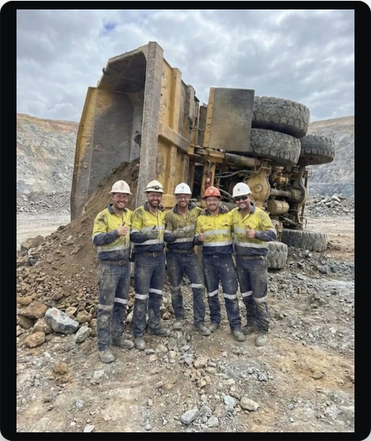
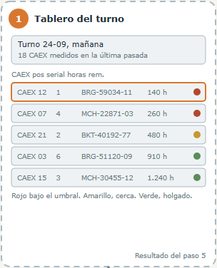
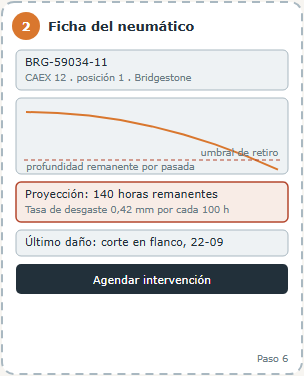
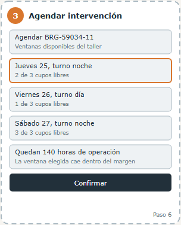
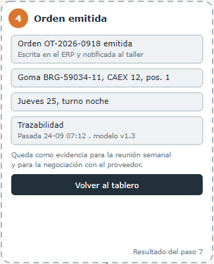
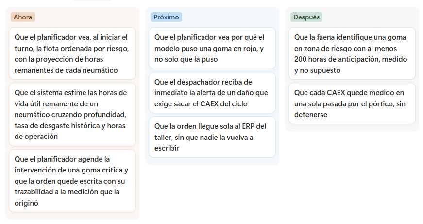

# Pórtico dimensional predictivo de neumáticos CAEX

Pórtico instrumentado que mide cada CAEX en tránsito, mantiene la historia dimensional de cada neumático por su serial y proyecta sus horas de vida útil remanente. Con eso, el planificador programa el retiro **antes** de que el neumático falle en faena y cada orden de trabajo queda trazada a la medición que la originó.

**Beneficiarios:** el planificador de mantención de neumáticos (usuario principal), el despachador de mina (alertas de daño crítico), el taller de neumáticos (órdenes con cupo asegurado) y la gerencia de mantenimiento (respaldo para reclamos de garantía ante el proveedor).

| Enlace | |
|---|---|
| Prototipo en producción (Vercel, rama `main`) | https://control-neumaticos-caex-frontend.vercel.app |
| Base de datos | Supabase, proyecto `vwustghenvatlfwankqo` |
| Gestión (Roadmap y Kanban en Notion) | [Grupo 3 (página del curso)](https://app.notion.com/p/Grupo-3-b76498f17d47839d8bf701014eb9d394) |

## Estado actual en la escala de madurez

**Semana 4: Prototipo de alta fidelidad conectado a datos (camino hacia la PoC de la Semana 8).**

| Hito | Estado |
|---|---|
| Desafío (Semana 1) | ✅ Avance 1 |
| Solución / Hipótesis (Semana 2) | ✅ Avance 2 |
| Ambiente integrado y datos (Semana 3) | ✅ GitHub (`dev` → `main` por Pull Request), Vercel con despliegue continuo y Supabase con [modelo de datos](docs/datos.md) |
| Historias, BDD y wireframes (Semana 4) | ✅ [`docs/historias.md`](docs/historias.md) y [`docs/wireframes/`](docs/wireframes/README.md) |
| Prueba de concepto (Semana 8) | 🔄 Método validado con datos sintéticos ([`docs/modelo.md`](docs/modelo.md)); falta integrarlo al prototipo y validarlo con datos reales |
| MVP (Semana 12) | ⏳ Validación con planificadores reales |

El prototipo trabaja con **datos sintéticos** (67 CAEX, 402 neumáticos); el hardware del pórtico queda fuera del semestre (horizonte *Después* del roadmap).

Documentación de los avances del proyecto:

- **Avance 1:** propuesta de valor
- **Avance 2:** propuesta de solución, caso de uso principal, maqueta preliminar y roadmap inicial
- **Entrega 3:** ambiente integrado, [bitácora de IA](docs/bitacora-ia.md) y [modelo de datos](docs/datos.md)
- **Entrega 4:** [historias de usuario y criterios BDD](docs/historias.md), y [wireframes anotados](docs/wireframes/README.md)

Ingeniería Digital en Acción: Datos con IA, MVP · Unidad 1 · Equipo 3
Universidad de Santiago de Chile

## Equipo

| Integrante | Rol | Responsabilidades |
|---|---|---|
| Manuel Ávalos Castillo | Técnico (programación) | Programa el prototipo con asistencia de IA (registrada en [`docs/bitacora-ia.md`](docs/bitacora-ia.md)); administra el repositorio, Vercel, Supabase y las credenciales; abre los Pull Requests desde `dev` |
| Héctor Medina | QA/QC y documentación | Prueba los flujos contra los escenarios de [`docs/historias.md`](docs/historias.md), revisa y aprueba los Pull Requests, y mantiene README, `docs/` y Notion |
| Francisco Opazo | Funcional | Valida la solución con el planificador de neumáticos y conduce la prueba de la Semana 7 |
| Nicolás Echeverría | _por definir_ | |

Rodrigo Erazo participó en los avances 1 y 2 y dejó el curso.

## Avance 1: propuesta de valor

### Problemática y beneficiario

**El costo oculto de los neumáticos OTR.** Es el mayor costo variable de una faena a cielo abierto y hoy se gestiona mediante inspecciones por muestreo.



*Un CAEX volcado tras la falla de un neumático en operación.*

**Quién lo sufre:** las Superintendencias de Servicios Mina y las Gerencias de Mantenimiento de faenas a cielo abierto con flotas de 20 CAEX o más (Cat 793, 797 y 798; Komatsu 930E y 960E). El retiro de cada neumático lo define el planificador de Mantención de Neumáticos, basándose principalmente en inspecciones por muestreo.

**La evidencia**

| Cifra | Significado |
|---|---|
| **US$40M** | En neumáticos por faena tipo: 6 unidades por 120 CAEX por unos US$55.000. En una faena de 20 CAEX son US$6,6M |
| **~30%** | De los neumáticos muere prematuramente, por corte, impacto o desgaste |
| **15 a 30 min** | De inspección manual por CAEX, subjetiva y hecha por muestreo |

**Qué pasa si no se resuelve.** Una falla de neumático en operación puede detener la rampa y generar riesgos para la continuidad operacional. Y sin historia por serial, la faena no tiene data dura para negociar frente al fabricante (Michelin, Bridgestone o BKT).

### Propuesta de valor

**Del muestreo manual a la proyección de vida útil:** medir cada CAEX en tránsito mediante un pórtico instrumentado, mantener el historial dimensional de cada neumático identificado por su número de serie y estimar su vida útil remanente para programar su retiro antes de que falle.

**Por qué es mejor que las alternativas actuales**

| Hoy | Con el pórtico |
|---|---|
| Muestreo humano, 15 a 30 min por CAEX | Una pasada a 2 a 5 km/h, sin detener el camión |
| Inspección por muestreo: cobertura limitada de la flota | Seis neumáticos de cada CAEX, en cada pasada por el pórtico |
| Subjetiva y sujeta a fatiga | Objetiva: escáner 3D, cámaras de daño y termografía |
| Sin historia individual del neumático | Historia dimensional por serial y posición |
| Reactiva: el neumático ya falló | Predictiva: el retiro se programa con anticipación |

**Cobertura de la banda de rodadura.** Al girar la rueda, se observan sucesivamente distintas zonas de la banda de rodadura. La cobertura de todo su ancho y circunferencia es un objetivo para validar mediante la ubicación de sensores y las pruebas de captura en tránsito.

**Qué construiremos en el semestre.** Se desarrollarán el tablero del planificador y el modelo de proyección a partir de datos sensoriales sintéticos. La instalación del pórtico instrumentado, que será la fuente de datos, no forma parte de esta etapa.

## Avance 2: propuesta de solución, caso de uso, maqueta y roadmap

### Propuesta de solución

Proponemos reducir las fallas imprevistas de neumáticos OTR y las detenciones no planificadas mediante un sistema que entregue al planificador de Mantención de Neumáticos una **proyección de vida útil por neumático**, basada en mediciones de un pórtico instrumentado y en el historial asociado a cada número de serie. Evaluaremos su efectividad mediante la reducción de los retiros por fallas imprevistas y el aumento de la vida útil promedio de los neumáticos.

El sistema integra captura automática de datos, gestión del historial y herramientas para programar intervenciones. Su principal aporte es transformar las mediciones en proyecciones de vida útil que apoyen la toma de decisiones y la planificación del mantenimiento.

> **Meta:** identificar condiciones de riesgo con al menos **200 horas de anticipación** al posible punto de falla. Es una hipótesis que deberá validarse con datos operacionales; no constituye una capacidad demostrada del prototipo.

### Caso de uso principal

| | |
|---|---|
| **Actor primario** | Planificador de Mantención de Neumáticos, responsable de programar retiros, rotaciones e intervenciones al inicio de cada turno |
| **Objetivo** | Programar intervenciones preventivas en neumáticos con riesgo de falla, con al menos 200 horas de anticipación respecto del punto probable de falla (sujeto a validación operacional) |
| **Precondición** | El pórtico está instalado en un punto obligatorio de tránsito de la flota (por ejemplo, la salida del taller o la zona de abastecimiento de combustible) y calibrado. Cada neumático tiene su número de serie registrado y al menos dos mediciones dimensionales previas. El planificador dispone del tablero al inicio de cada turno |
| **Postcondición** | Los neumáticos críticos quedan programados para intervención antes de una posible falla en operación. El historial dimensional se actualiza automáticamente. El ERP registra la orden con trazabilidad al pórtico y a la proyección del modelo, como respaldo para la planificación semanal y las gestiones con Michelin, Bridgestone o BKT |

#### Escenario principal de éxito

1. Un CAEX atraviesa el pórtico a una velocidad entre 2 y 5 km/h. Al detectar su paso, los sensores se sincronizan y capturan la condición de los seis neumáticos en una sola pasada.
2. El escáner 3D reconstruye la banda de rodadura y estima la profundidad remanente en cada posición con precisión milimétrica. Las cámaras identifican cortes, rocas incrustadas y desgastes irregulares, y la termografía registra la temperatura superficial de cada flanco.
3. El sistema identifica cada neumático mediante la lectura de su número de serie grabado en el costado o por RFID, cuando esté disponible, y confirma su posición en el camión.
4. El sistema registra profundidad, daños, temperatura y horas de operación en el historial de cada neumático y recalcula su vida útil remanente considerando el desgaste histórico y las condiciones de la ruta del CAEX.
5. El sistema clasifica cada neumático en condición **verde, amarilla o roja** según su riesgo y su proximidad al umbral de retiro seguro, y publica el listado en el tablero de priorización del turno.
6. El planificador revisa el tablero, identifica los neumáticos en rojo o en amarillo cercanos al umbral, y programa su intervención en la próxima ventana disponible del taller.
7. El sistema notifica al taller, genera la orden de trabajo en el ERP y registra el evento con trazabilidad completa, como respaldo para la planificación semanal y la gestión técnica con el proveedor.

#### Extensiones

- **3a. Número de serie no identificable** (suciedad, ángulo desfavorable o desgaste del flanco): se conserva la medición asociada al CAEX y a su posición, la identificación queda pendiente y se programa una nueva lectura. Tras tres pasadas consecutivas sin identificar, se genera una tarea de verificación manual para el operador del punto de control.
- **4a. Medición fuera de tolerancia** (suciedad o interferencias): se descarta, se mantiene la proyección vigente y se solicita una nueva pasada con la superficie limpia. Tras tres mediciones consecutivas fuera de tolerancia del mismo neumático, se emite una alerta para revisar el pórtico.
- **5a. Daño crítico** (corte profundo en el flanco, sobrecalentamiento localizado o signos de delaminación): se alerta de inmediato al despachador y al planificador, antes de la priorización habitual. El CAEX es derivado al taller para su evaluación antes de retomar la operación.

### Maqueta digital preliminar

Cuatro pantallas del flujo principal. Los pasos 1 a 4 del escenario son procesos automáticos. El paso 5 publica el tablero de la pantalla 1; desde el paso 6 interactúa el planificador, que consulta la ficha y agenda la intervención en las pantallas 2 y 3. La pantalla 4 muestra la orden emitida (paso 7). La disposición y los elementos visuales son preliminares.

| 1. Tablero del turno | 2. Ficha del neumático |
|---|---|
|  |  |
| **3. Agendar intervención** | **4. Orden emitida** |
|  |  |

Versión navegable en Figma: [Maqueta de sistema de mantenimiento](https://www.figma.com/make/EDZNEzovnKPwBaUDV0GySq/Maqueta-de-sistema-de-mantenimiento)

#### Herramientas que la maqueta revela

| Característica | Pantalla | Decisión técnica |
|---|---|---|
| Flota ordenada por nivel de riesgo | 1 | Un modelo de proyección y un entorno de ejecución que calculen la vida útil remanente por neumático y por turno |
| Zonas verde, amarilla y roja | 1 | Umbrales de retiro seguro configurables según el tipo de neumático y las condiciones de la faena |
| Curva de desgaste de la ficha | 2 | Una serie temporal por serial que conserve profundidad, temperatura y horas de operación de cada medición |
| Ventana del taller | 3 | Un modelo de capacidad del taller con turnos y cupos disponibles, o una integración con el sistema existente |
| Orden escrita en el ERP | 4 | Una integración con el ERP que defina credenciales, estructura de datos y tratamiento de órdenes rechazadas |
| Trazabilidad de la orden a su medición | 4 | Un registro que vincule cada orden con la medición y la versión del modelo que la originaron |
| Alerta al despachador (extensión 5a) | 1 | Un rol de despachador y un canal de notificación prioritaria para daños que requieren atención inmediata |

### Roadmap inicial

El roadmap reúne ocho resultados esperados distribuidos en **Ahora, Próximo y Después** ([página del proyecto en Notion](https://app.notion.com/p/Grupo-3-b76498f17d47839d8bf701014eb9d394)).



Durante el semestre se desarrollarán el tablero del planificador y el modelo de proyección con **datos sensoriales sintéticos**. La instalación del pórtico corresponde a una etapa posterior.

La meta de anticipación de 200 horas se ubica en *Después*, porque debe contrastarse con la evolución real de los neumáticos y sus fallas registradas. El prototipo permitirá evaluar el funcionamiento del flujo con datos sintéticos, pero no acreditar esa anticipación ni una reducción de fallas en operación.

## Flujo de ramas

- `dev`: desarrollo diario. Todo cambio se sube aquí (`actualizar.bat "mensaje"`).
- `main`: producción. Solo recibe cambios mediante Pull Request desde `dev`; Vercel despliega `main` automáticamente.

## Estructura del repositorio

```
├── .env.example             # Plantilla de variables de entorno (Supabase / API)
├── .gitignore               # Configuración de exclusión para Git
├── README.md                # Portada ejecutiva y documentación general
├── CHANGELOG.md             # Registro de versiones y avances
├── actualizar.bat           # Atajo Windows: commit y push a la rama dev
├── src/                     # Código fuente vigente (SPA desplegada en Vercel)
│   ├── index.html           # Interfaz: tablero, camiones 6x4, ficha, agenda, órdenes, simulador, datos y modelos
│   ├── config.js            # URL y clave anon (pública) de Supabase
│   ├── db.js                # Capa de datos: lee y escribe en Supabase (respaldo local)
│   └── assets/              # Imágenes del CAEX y del pórtico
├── frontend/                # VERSIÓN ANTIGUA (Entrega 4), solo referencia histórica
├── modelo/                  # PoC del modelo de desgaste y vida útil remanente (Python)
│   ├── generar_datos.py     # Datos sintéticos con efectos conocidos
│   ├── entrenar.py          # Regresión, Gradient Boosting + SHAP, supervivencia (Cox) y validación
│   └── resultados/          # REPORTE.md, métricas y gráficos
├── scripts/
│   ├── generar_seed.py      # Genera docs/seed.sql desde los datos del prototipo
│   └── wireframes/          # Genera los wireframes anotados desde el prototipo
├── backend/                 # Microservicio API en FastAPI (Python 3.11)
│   ├── app/
│   │   ├── main.py          # Endpoints REST (datos de ejemplo de la flota CAEX)
│   │   └── proyeccion.py    # Algoritmo de regresión lineal y semáforo (200h / 500h)
│   ├── tests/               # Pruebas unitarias de regresión y semáforo
│   └── requirements.txt     # Dependencias de Python
└── docs/                    # Documentación formal de la entrega
    ├── historias.md         # Historias HU-01 a HU-08 (INVEST) con escenarios Gherkin
    ├── datos.md             # Diccionario de datos y reglas Tidy Data
    ├── bitacora-ia.md       # Uso auditado de asistentes de IA
    ├── modelo.md            # Metodología del modelo de desgaste y RUL (PoC Semana 8)
    ├── experiencia-usuario.md # Mapa de experiencia, flujo de pantallas y especificaciones
    ├── propuestas.md        # Registro de propuestas PROP-NN (metodología de cambios)
    ├── historico/           # Versiones reemplazadas (solo referencia)
    ├── schema.sql           # DDL Supabase: tablas, triggers de cupos, vista y políticas RLS
    ├── seed.sql             # Datos de demostración: 67 CAEX, 402 neumáticos, órdenes
    ├── ARQUITECTURA.md      # Arquitectura técnica desacoplada (Frontend/Backend/Supabase)
    ├── prompt-figma.md      # Especificación para Figma Make
    ├── wireframes/          # Wireframes anotados W1 a W5 (PNG con marcas [1] a [4])
    └── img/                 # Diagramas y capturas de interfaz
```

## Cómo ejecutar en local

El prototipo es HTML, CSS y JavaScript sin compilación: **no requiere `npm install` ni `npm run dev`**. Basta un servidor web estático.

**Requisitos:** Git, Python 3 (solo para el servidor local) y un navegador.

```bash
git clone https://github.com/mavalosc/control-neumaticos-caex.git
cd control-neumaticos-caex
git checkout dev                      # trabajar siempre en dev
cp .env.example .env                  # variables locales (no se suben a GitHub)
cd src && python -m http.server 8000  # abrir http://localhost:8000
```

Variables de entorno: `.env.example` documenta qué se necesita. El navegador lee la URL y la clave **anon** desde `src/config.js`. La clave `service_role` solo va en `.env` local y **nunca** en el código.

Pasos de configuración completos:

1. **Base de Datos (Supabase):** en el SQL Editor del proyecto ejecutar, en orden:
   1. [`docs/schema.sql`](docs/schema.sql): tablas, enums, triggers de cupos, vista del tablero y políticas RLS.
   2. [`docs/seed.sql`](docs/seed.sql): flota de demostración (67 CAEX, 402 neumáticos, ventanas y órdenes). Reinicia los datos cada vez que se ejecuta.

   Si se cambian los datos iniciales en `src/index.html`, regenerar el seed con `python scripts/generar_seed.py`.

2. **Frontend (local y Vercel):** completar `src/config.js` con la URL y la clave **anon** del proyecto (nunca la `service_role`).
   Para probar en local: `cd src && python -m http.server 8000` y abrir http://localhost:8000.
   El indicador de la barra superior muestra **Supabase** cuando lee y escribe en la base, o **modo local** si no hay conexión (en ese caso usa `localStorage`).
   En Vercel, el *Root Directory* es `src` y la rama de producción es `main`.

3. **Backend API (FastAPI):**
   ```bash
   cd backend
   python -m venv .venv && source .venv/bin/activate
   pip install -r requirements.txt
   uvicorn app.main:app --reload      # http://localhost:8000/docs
   pytest
   ```

Documentación formal:
- Historias de Usuario INVEST y BDD: [`docs/historias.md`](docs/historias.md)
- Modelo y Diccionario de Datos: [`docs/datos.md`](docs/datos.md) (implementado en [`docs/schema.sql`](docs/schema.sql))
- Bitácora de uso de IA: [`docs/bitacora-ia.md`](docs/bitacora-ia.md)
- Manual de uso: [`src/manual.md`](src/manual.md) (también en la app, en Ayuda, y en [PDF](src/assets/manual/manual-control-neumaticos-caex.pdf))
- Experiencia de usuario y especificaciones: [`docs/experiencia-usuario.md`](docs/experiencia-usuario.md)
- Registro de propuestas de cambio: [`docs/propuestas.md`](docs/propuestas.md)
- Modelo de desgaste y vida útil remanente: [`docs/modelo.md`](docs/modelo.md) · [resultados de la PoC](modelo/resultados/REPORTE.md)
- Arquitectura del Sistema: [`docs/ARQUITECTURA.md`](docs/ARQUITECTURA.md)
- Wireframes Anotados de Flujo: [`docs/wireframes/README.md`](docs/wireframes/README.md)
- Roadmap y Kanban en Notion: [Grupo 3 (página del curso)](https://app.notion.com/p/Grupo-3-b76498f17d47839d8bf701014eb9d394)
- Maqueta Navegable en Figma: [Prototipo Figma](https://www.figma.com/make/EDZNEzovnKPwBaUDV0GySq/Maqueta-de-sistema-de-mantenimiento)

