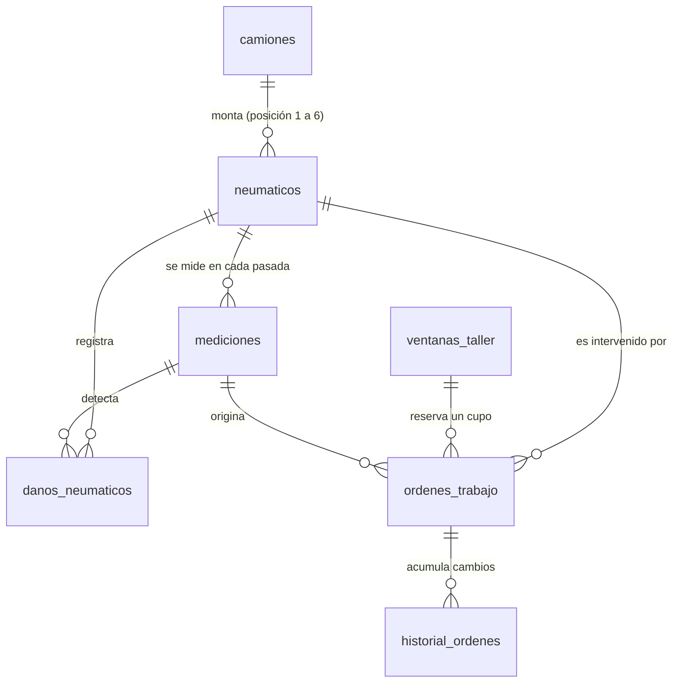

# Modelo de Datos y Diccionario (Supabase · PostgreSQL)
## Pórtico Dimensional Predictivo de Neumáticos CAEX · Equipo 3

- **Implementación:** [`docs/schema.sql`](schema.sql) (tablas, triggers, vista y políticas RLS) y [`docs/seed.sql`](seed.sql) (datos de demostración).
- **Proyecto Supabase:** `vwustghenvatlfwankqo`.
- **Datos de ejemplo:** valores reales de la base de demostración (67 CAEX, 405 neumáticos).

---

## 1. Origen del modelo: entidades del caso de uso

Las tablas salen de los sustantivos del caso de uso principal de la Semana 2: *"el pórtico **mide** cada **CAEX** en tránsito; el sistema mantiene la historia dimensional por **serial de neumático**, proyecta sus horas remanentes y detecta **daños**; el planificador agenda la intervención en una **ventana del taller** y emite la **orden de trabajo**, cuyos cambios quedan en un **historial**"*.

| Sustantivo del caso de uso | Tabla | Historias que la usan |
|---|---|---|
| CAEX (camión de extracción) | `camiones` | HU-01, HU-03 |
| Neumático identificado por serial | `neumaticos` | HU-01, HU-03, HU-04 |
| Medición del pórtico (pasada) | `mediciones` | HU-01, HU-04 |
| Daño detectado o validado | `danos_neumaticos` | HU-02, HU-04, HU-05 |
| Ventana del taller con cupos | `ventanas_taller` | HU-06, HU-07, HU-08 |
| Orden de trabajo (OT) | `ordenes_trabajo` | HU-07, HU-08 |
| Cambio auditado de una OT | `historial_ordenes` | HU-07, HU-08 |

### Diagrama entidad-relación

---

## 2. Diccionario de datos

Convenciones: **PK** clave primaria, **FK** clave foránea. *Requerido* significa `NOT NULL` (o clave primaria); *Opcional* admite `NULL`.

### 2.1 `camiones`: un CAEX de la flota

| Campo | Tipo de dato | Obligatoriedad | Valor de ejemplo |
|---|---|---|---|
| `id` | UUID | Requerido (PK) | `e1bca579-005b-4cad-b0eb-f28666cd5155` |
| `codigo` | VARCHAR(20), único | Requerido | `CAEX-102` |
| `modelo` | VARCHAR(50) | Requerido | `Cat 793F` |
| `horometro_h` | INTEGER | Requerido | `13622` |
| `estado_operacional` | VARCHAR(30) | Opcional | `operativo` |
| `creado_en` | TIMESTAMPTZ | Opcional (por defecto `now()`) | `2026-10-14T22:54:57Z` |

### 2.2 `neumaticos`: un neumático OTR identificado por su serial

| Campo | Tipo de dato | Obligatoriedad | Valor de ejemplo |
|---|---|---|---|
| `id` | UUID | Requerido (PK) | `607a7246-f2fd-4857-a2a5-ae0f1f268e5c` |
| `serial` | VARCHAR(50), único | Requerido | `5980R63-2426-1348` |
| `caex_id` | UUID | Opcional (FK → `camiones.id`; `NULL` si está desmontado) | `e1bca579-005b-4cad-b0eb-f28666cd5155` |
| `posicion` | INTEGER, entre 1 y 6 | Opcional | `3` |
| `marca` | VARCHAR(30) | Requerido | `Bridgestone` |
| `medida` | VARCHAR(20) | Opcional | `59/80R63` |
| `umbral_retiro_mm` | NUMERIC(4,1) | Requerido | `20.0` |
| `creado_en` | TIMESTAMPTZ | Opcional (por defecto `now()`) | `2026-10-14T22:54:57Z` |

### 2.3 `mediciones`: una pasada del neumático por el pórtico

| Campo | Tipo de dato | Obligatoriedad | Valor de ejemplo |
|---|---|---|---|
| `id` | UUID | Requerido (PK) | `f3523ae8-a0a5-41c7-9121-828073fadb7f` |
| `codigo_medicion` | VARCHAR(30), único | Requerido | `med-3009` |
| `neumatico_id` | UUID | Requerido (FK → `neumaticos.id`) | `607a7246-f2fd-4857-a2a5-ae0f1f268e5c` |
| `fecha_pasada` | TIMESTAMPTZ | Opcional (por defecto `now()`) | `2026-09-24T11:00:00Z` |
| `horas_operacion` | INTEGER | Requerido | `13622` |
| `profundidad_mm` | NUMERIC(4,1) | Requerido | `20.4` |
| `tasa_desgaste_por_100h` | NUMERIC(4,2) | Requerido | `1.17` |
| `tipo_tasa` | VARCHAR(20) | Opcional | `observada` |
| `temperatura_flanco_c` | NUMERIC(4,1) | Opcional | `104.0` |
| `horas_remanentes_calculadas` | INTEGER | Requerido | `34` |
| `zona_calculada` | ENUM `zona_criticidad_enum` (rojo, amarillo, verde, gris) | Requerido | `rojo` |
| `modelo_version` | VARCHAR(20) | Opcional | `v1.3` |
| `imagen_escaneo_url` | TEXT | Opcional | `https://…/storage/v1/object/public/escaneos/med-3009.png` |
| `creado_en` | TIMESTAMPTZ | Requerido (por defecto `now()`) | `2026-10-14T22:54:57Z` |

### 2.4 `danos_neumaticos`: un daño detectado por el modelo o validado por una persona

| Campo | Tipo de dato | Obligatoriedad | Valor de ejemplo |
|---|---|---|---|
| `id` | UUID | Requerido (PK) | `4a33cc22-5c9f-4ec1-8999-1a2c4cdf7c89` |
| `medicion_id` | UUID | Opcional (FK → `mediciones.id`) | `f3523ae8-a0a5-41c7-9121-828073fadb7f` |
| `neumatico_id` | UUID | Requerido (FK → `neumaticos.id`) | `607a7246-f2fd-4857-a2a5-ae0f1f268e5c` |
| `severidad` | ENUM `severidad_dano_enum` ('0' a '3') | Requerido | `3` |
| `descripcion` | TEXT | Opcional | `corte profundo en flanco` |
| `confianza_ia` | NUMERIC(3,2) | Opcional | `0.94` |
| `validado_por_humano` | BOOLEAN | Opcional | `false` |
| `usuario_validador` | VARCHAR(50) | Opcional | `planificador` |
| `fecha_registro` | TIMESTAMPTZ | Opcional (por defecto `now()`) | `2026-10-14T22:54:57Z` |
| `creado_en` | TIMESTAMPTZ | Requerido (por defecto `now()`) | `2026-10-14T22:54:57Z` |

### 2.5 `ventanas_taller`: un turno del taller con capacidad limitada

| Campo | Tipo de dato | Obligatoriedad | Valor de ejemplo |
|---|---|---|---|
| `id` | SERIAL (INTEGER) | Requerido (PK) | `1` |
| `dia` | DATE | Requerido | `2026-09-29` |
| `turno` | VARCHAR(30) | Requerido | `turno B, 20:00 a 00:00` |
| `cupos_totales` | INTEGER | Requerido | `3` |
| `cupos_libres` | INTEGER | Requerido (los ajustan los triggers) | `2` |
| `horas_hasta_ventana` | INTEGER | Requerido | `36` |
| `reservable` | BOOLEAN | Requerido | `true` |
| `creado_en` | TIMESTAMPTZ | Opcional (por defecto `now()`) | `2026-10-14T22:54:57Z` |

### 2.6 `ordenes_trabajo`: una OT emitida al taller (y al ERP)

| Campo | Tipo de dato | Obligatoriedad | Valor de ejemplo |
|---|---|---|---|
| `id` | UUID | Requerido (PK) | `5aab7e33-bce3-462b-8de5-107d44e6a646` |
| `codigo` | VARCHAR(20), único | Requerido | `ot-0068` |
| `fecha_emision` | TIMESTAMPTZ | Opcional (por defecto `now()`) | `2026-09-26T13:59:00Z` |
| `neumatico_id` | UUID | Requerido (FK → `neumaticos.id`) | `6a386a8e-c03d-4406-a42a-735f5bf6c2b2` |
| `ventana_id` | INTEGER | Requerido (FK → `ventanas_taller.id`) | `4` |
| `medicion_origen_id` | UUID | Opcional (FK → `mediciones.id`) | `NULL` |
| `medicion_codigo` | VARCHAR(30) | Opcional | `med-2494` |
| `origen_detalle` | TEXT | Opcional | `22,9 mm, tasa observada` |
| `tipo_intervencion` | ENUM `tipo_intervencion_enum` (retiro, rotacion, inspeccion) | Requerido | `retiro` |
| `justificacion_nota` | TEXT | Requerido | `Retiro programado por proyección de 150 h remanentes…` |
| `horas_remanentes_emision` | INTEGER | Requerido | `150` |
| `serial_reemplazo_bodega` | VARCHAR(50) | Opcional | `5980R63-B-544` |
| `estado` | ENUM `estado_orden_enum` (programada, ejecutada, anulada) | Requerido | `programada` |
| `actualizado_en` | TIMESTAMPTZ | Opcional (por defecto `now()`) | `2026-10-14T22:54:57Z` |

### 2.7 `historial_ordenes`: un cambio auditado de una OT

| Campo | Tipo de dato | Obligatoriedad | Valor de ejemplo |
|---|---|---|---|
| `id` | UUID | Requerido (PK) | `8d7807fb-74a2-4ea0-ac73-3c6ab0891ff2` |
| `orden_id` | UUID | Requerido (FK → `ordenes_trabajo.id`) | `5aab7e33-bce3-462b-8de5-107d44e6a646` |
| `fecha_evento` | TIMESTAMPTZ | Opcional (por defecto `now()`) | `2026-09-26T13:59:00Z` |
| `autor` | VARCHAR(50) | Requerido | `planificador` |
| `accion` | VARCHAR(50) | Requerido | `creacion`, `modificacion`, `anulacion` |
| `motivo` | TEXT | Requerido | `El neumático ya se rotó` |
| `detalles` | JSONB | Opcional | `{"ventana_anterior": 4, "ventana_nueva": 1}` |
| `creado_en` | TIMESTAMPTZ | Requerido (por defecto `now()`) | `2026-10-14T22:54:57Z` |

### 2.8 Vista `vista_tablero_turno` (solo lectura)
Cruza cada neumático montado con su **última** medición y su **último** daño. Alimenta el tablero (HU-01), la vista de camiones (HU-03) y la ficha (HU-04). No almacena datos: los calcula en cada consulta.

---

### 2.9 Tablas de datos de terreno simulados y del modelo (PROP-06)

Toda fila lleva **`origen`** (`simulado` hoy; `real` cuando existan datos de la faena). La app solo las **lee**; las escribe GitHub Actions cada día con la clave `service_role`.

#### `ciclos_operacion`: un día de operación SIMULADO de un neumático montado

| Campo | Tipo de dato | Obligatoriedad | Valor de ejemplo |
|---|---|---|---|
| `id` | UUID | Requerido (PK) | `0b1e…` |
| `neumatico_id` | UUID | Requerido (FK → `neumaticos.id`) | `607a7246-…` |
| `serial`, `caex_codigo`, `posicion` | VARCHAR, VARCHAR, INTEGER | Requerido | `5980R63-2426-1348`, `CAEX-102`, `3` |
| `vida`, `ciclo` | INTEGER | Requerido (único con `neumatico_id`) | `1`, `57` |
| `fecha` | DATE | Requerido | `2026-10-25` |
| `horas_ciclo`, `horas_vida` | NUMERIC | Requerido | `19.4`, `1062.0` |
| `presion_desv_pct`, `presion_psi` | NUMERIC | Requerido | `-3.20`, `98.7` |
| `temp_neumatico_c`, `temp_ambiente_c` | NUMERIC | Requerido | `88.4`, `17.2` |
| `carga_t`, `velocidad_kmh`, `distancia_km` | NUMERIC | Requerido | `231.5`, `20.40`, `336.4` |
| `terreno` | VARCHAR (`compactado`, `roca_suelta`, `barro`) | Requerido | `roca_suelta` |
| `pendiente_pct`, `frenadas_por_h`, `tkph` | NUMERIC | Requerido | `7.10`, `11.30`, `945.2` |
| `profundidad_mm` | NUMERIC(5,2) | Requerido | `41.27` (con ruido del pórtico) |
| `profundidad_real_simulada` | NUMERIC(6,3) | Requerido | `41.402` (sin ruido; solo para continuar la simulación) |
| `tasa_real_simulada` | NUMERIC(6,4) | Requerido | `2.0571` (verdad del simulador; solo para evaluar, **nunca** es insumo del modelo) |
| `origen` | VARCHAR (`simulado`, `real`) | Requerido | `simulado` |
| `creado_en` | TIMESTAMPTZ | Requerido | `2026-10-25T09:04:11Z` |

#### `modelo_versiones`: cada entrenamiento diario

| Campo | Tipo de dato | Obligatoriedad | Valor de ejemplo |
|---|---|---|---|
| `id` | UUID | Requerido (PK) | `5c2d…` |
| `version` | VARCHAR(40), único | Requerido | `gb-terreno-20261025` |
| `fecha_entrenamiento` | TIMESTAMPTZ | Requerido | `2026-10-25T09:05:02Z` |
| `algoritmo` | VARCHAR(60) | Requerido | `Gradient Boosting (HistGradientBoostingRegressor) + SHAP` |
| `n_ciclos`, `n_ventanas`, `camiones_prueba` | INTEGER | Requerido | `60300`, `5963`, `14` |
| `mae_tasa_modelo`, `mae_tasa_promedio` | NUMERIC(6,4) | Requerido | `0.1380`, `0.6540` (mm/100 h, camiones no vistos) |
| `importancia` | JSONB | Opcional | `{"Temperatura del neumático": 0.143, …}` |
| `origen` | VARCHAR | Requerido | `simulado` |

#### `predicciones_modelo`: predicción diaria por neumático

| Campo | Tipo de dato | Obligatoriedad | Valor de ejemplo |
|---|---|---|---|
| `id` | UUID | Requerido (PK) | `9a40…` |
| `neumatico_id` | UUID | Requerido (FK → `neumaticos.id`) | `607a7246-…` |
| `serial` | VARCHAR(50) | Requerido | `5980R63-2426-1348` |
| `modelo_version` | VARCHAR(40) | Requerido (FK → `modelo_versiones.version`) | `gb-terreno-20261025` |
| `fecha_prediccion` | TIMESTAMPTZ | Requerido | `2026-10-25T09:05:30Z` |
| `profundidad_mm` | NUMERIC(5,2) | Requerido | `19.80` (última medición del pórtico) |
| `tasa_prevista_mm_100h` | NUMERIC(6,3) | Requerido | `2.571` |
| `horas_remanentes_modelo` | INTEGER | Requerido | `0` |
| `causas` | JSONB | Requerido | `[{"etiqueta": "Presión de inflado", "efecto": "aumenta", "peso_pct": 31.8}, …]` |
| `origen` | VARCHAR | Requerido | `simulado` |

Vistas de apoyo: **`vista_ultimo_ciclo`** (último ciclo de cada neumático, para continuar la simulación) y **`vista_prediccion_actual`** (última predicción de cada neumático, la que muestra la app).

## 3. Reglas de Tidy Data (Wickham)

| Regla | Cómo se cumple |
|---|---|
| **1. Cada fila es una única observación o entidad** | Una fila de `mediciones` es **una pasada de un neumático** por el pórtico, no un camión ni un turno. Una fila de `danos_neumaticos` es **un daño** en un momento dado. Las correcciones del planificador (HU-05) no sobrescriben la fila anterior: se agregan como filas nuevas, así se conservan el juicio de la IA y el humano. |
| **2. Cada columna es una sola variable** | No hay columnas que mezclen valores. La profundidad (`profundidad_mm`), la tasa (`tasa_desgaste_por_100h`) y la temperatura (`temperatura_flanco_c`) van separadas y con su unidad en el nombre. Las posiciones P1 a P6 son **filas** de `neumaticos` (campo `posicion`), no seis columnas en `camiones`. |
| **3. Trazabilidad con claves y auditoría temporal** | Todas las entidades tienen clave primaria UUID, salvo `ventanas_taller`, que usa un correlativo SERIAL porque es un catálogo interno del taller. Las relaciones son claves foráneas explícitas. Toda tabla registra cuándo se creó la fila (`creado_en`, `fecha_pasada`, `fecha_emision` o `fecha_evento`), y `ordenes_trabajo.actualizado_en` registra la última modificación. |

### Integridad garantizada por la base (no por el navegador)
- **Cupos del taller:** los triggers `trg_decrementar_cupo`, `trg_liberar_cupo_anulacion` y `trg_mover_cupo_cambio_ventana` descuentan, liberan o mueven cupos. La base rechaza una orden si la ventana no tiene cupo.
- **Sin borrado de órdenes:** no hay política `DELETE`. Una orden se **anula** y queda registrada.
- **Valores válidos:** los tipos ENUM limitan zona, severidad, estado e intervención; `posicion` solo admite valores de 1 a 6.

---

## 4. Seguridad (Row Level Security)

| Tabla | Leer (anon) | Insertar (anon) | Actualizar (anon) | Borrar |
|---|---|---|---|---|
| `camiones`, `neumaticos`, `ventanas_taller` | ✅ | ❌ | ❌ (solo los triggers) | ❌ |
| `mediciones`, `danos_neumaticos`, `historial_ordenes` | ✅ | ✅ | ❌ | ❌ |
| `ordenes_trabajo` | ✅ | ✅ | ✅ | ❌ |
| `ciclos_operacion`, `modelo_versiones`, `predicciones_modelo` | ✅ | ❌ (solo GitHub Actions con `service_role`) | ❌ | ❌ |

El frontend usa solo la clave **anon**, que es pública por diseño. La clave `service_role` no se usa en el código ni se publica. En una versión productiva, estas políticas se restringirían a usuarios autenticados según su rol (planificador o despachador).
