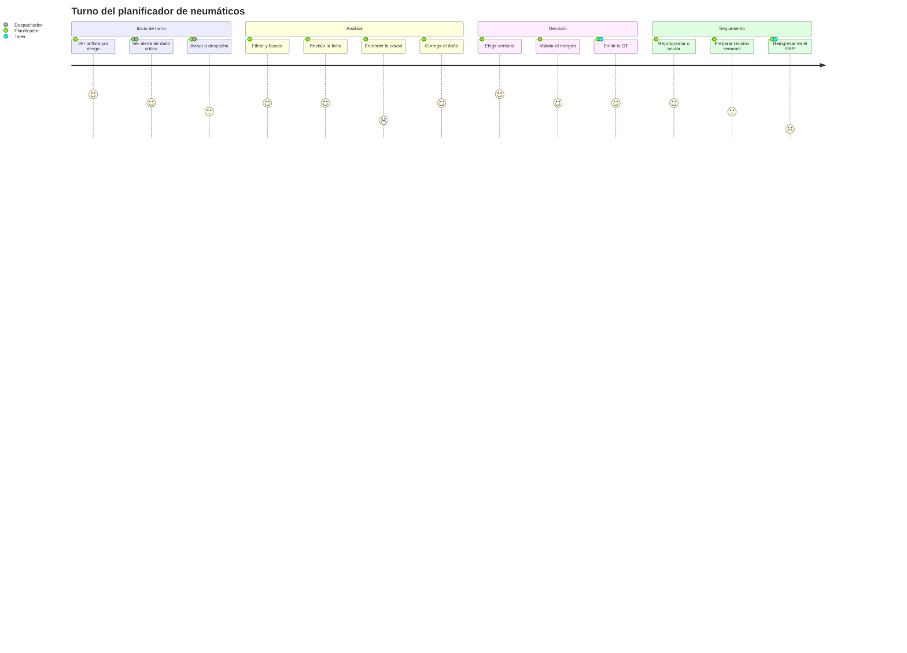
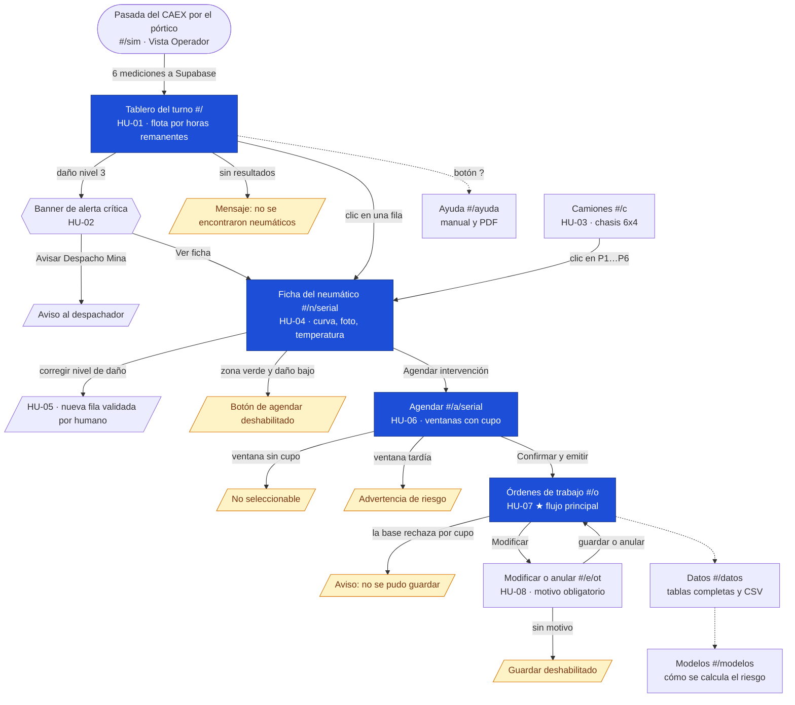
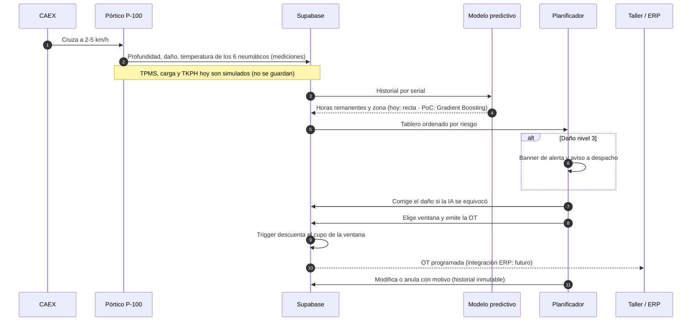

# Experiencia de usuario y especificaciones
## Herramienta predictiva de desgaste de neumáticos CAEX · Equipo 3

> Describe la herramienta en su versión v0.7 (24-10-2026) y lo que falta para llevarla a faena. Aplicación: https://control-neumaticos-caex-frontend.vercel.app
> Documentos relacionados: [historias de usuario](historias.md) · [modelo de datos](datos.md) · [modelo predictivo](modelo.md) · [wireframes](wireframes/README.md)

**Estados usados en este documento**

| Estado | Significado |
|---|---|
| ✅ Implementado | Funciona en el prototipo con datos guardados en Supabase |
| 🟡 Simulado | Funciona en la interfaz, pero con datos generados en el navegador (no se guardan) |
| 🧪 Prueba de concepto | Validado con datos sintéticos en `modelo/`; todavía no conectado al prototipo |
| ⏳ Futuro | Definido, sin implementar |

---

## 1. Usuarios

| Usuario | Objetivo principal | Cuándo usa la herramienta | Pantallas |
|---|---|---|---|
| **Planificador de mantención de neumáticos** (usuario principal) | Retirar cada neumático antes de que falle, con cupo asegurado en el taller | Al inicio de cada turno y cuando llega una alerta | Tablero, Camiones, Ficha, Agendar, Órdenes |
| **Despachador de mina** | Sacar del ciclo un CAEX con daño crítico | Cuando recibe una alerta de daño nivel 3 | Banner de alerta del Tablero |
| **Operador del pórtico** | Confirmar que la pasada se capturó completa | En cada pasada de un CAEX | Simulador del pórtico (Vista Operador) |
| **Ingeniería de confiabilidad** | Entender por qué se desgastan los neumáticos y validar el modelo | Revisiones semanales | Simulador (Vista Ingeniería), Datos, Modelos |
| **Profesor y evaluadores** | Revisar el flujo, la trazabilidad y los entregables | En cada entrega | Ayuda (sección para evaluadores), Datos, Modelos |
| **Taller de neumáticos** | Recibir órdenes con fecha, turno y serial de reemplazo | Al programar el turno del taller | Órdenes (vía ERP en el futuro) |

---

## 2. Mapa de experiencia del planificador

Recorrido de un turno típico. El puntaje (1 a 5) es una **hipótesis del equipo** sobre la experiencia con la herramienta actual: todavía no se ha medido con planificadores reales y se validará en la prueba funcional de la Semana 7. Los puntajes bajos marcan las oportunidades de mejora (sección 5).

---

## 3. Flujo de pantallas

Rutas reales del prototipo (`#/…`), con el código de la historia que cubre cada pantalla y las rutas de excepción.

---

## 4. De la pasada a la decisión

Qué ocurre detrás de la interfaz, desde que el CAEX cruza el pórtico hasta que el taller recibe la orden.

---

## 5. Puntos de dolor y oportunidades

| Paso del recorrido | Puntaje (hipótesis) | Dolor actual | Oportunidad | Especificación |
|---|---|---|---|---|
| Entender la causa | 2 | La ficha muestra la cifra, no la causa | Mostrar las 3 variables SHAP que más pesan en cada alerta | ESP-M-05 |
| Reingresar en el ERP | 1 | La OT queda en el prototipo; el taller la reescribe | Integración con SAP PM | ESP-D-05 |
| Avisar a despacho | 3 | El aviso queda solo en el navegador | Guardar el aviso en Supabase y notificar al despachador | ESP-F-03 |
| Preparar reunión semanal | 3 | Hay que armar el informe a mano | Descarga CSV desde el explorador de datos (ya existe) y un reporte semanal | ESP-F-14 |
| Pasada por el pórtico (operador) | — | La vista completa muestra 125 datos | Vista Operador por defecto con 23 datos | ESP-NF-05 |

---

## 6. Especificaciones

### 6.1 Funcionales

| ID | Especificación | Historia | Pantalla | Estado | Cómo se verifica |
|---|---|---|---|---|---|
| ESP-F-01 | Listar los neumáticos montados ordenados de menor a mayor horas remanentes, con zona, profundidad, tasa, temperatura y nivel de daño | HU-01 | Tablero | ✅ | Primera fila = menor horas; 402 neumáticos en 67 CAEX |
| ESP-F-02 | Filtrar por zona y tipo de tasa, buscar por serial o camión y paginar (25, 50, 100 o todos) | HU-01 | Tablero | ✅ | Búsqueda sin coincidencias muestra «No se encontraron neumáticos…» |
| ESP-F-03 | Mostrar un banner prioritario cuando un neumático tiene daño nivel 3 y permitir avisar a despacho | HU-02 | Tablero | ✅ banner · 🟡 el aviso no se guarda | Banner con camión, posición, daño, certeza y temperatura |
| ESP-F-04 | Ver cada CAEX con sus 6 posiciones coloreadas por zona y abrir la ficha desde cada posición | HU-03 | Camiones | ✅ | Clic en P3 abre la ficha del serial correcto |
| ESP-F-05 | Ficha con horas remanentes, profundidad contra el umbral, tasa, temperatura, curva de las últimas pasadas y daños con su confianza | HU-04 | Ficha | ✅ | Daño con confianza < 70 % muestra «por confirmar» |
| ESP-F-06 | Corregir el nivel de daño (0 a 3); la corrección se guarda como nueva fila validada por humano | HU-05 | Ficha | ✅ | Fila en `danos_neumaticos` con `validado_por_humano = true` |
| ESP-F-07 | Agendar solo en ventanas con cupo y advertir si la ventana llega después del cruce del umbral | HU-06 | Agendar | ✅ | Ventana con 0 cupos no se puede elegir; mensaje de margen o de riesgo |
| ESP-F-08 | Emitir la OT con correlativo, nota, medición de origen y ventana; descontar el cupo | HU-07 ★ | Órdenes | ✅ | Fila en `ordenes_trabajo` y cupo −1 por trigger |
| ESP-F-09 | Modificar ventana o nota y anular, siempre con motivo; las OT nunca se borran | HU-08 | Modificar | ✅ | Botón deshabilitado sin motivo; anulación libera cupo |
| ESP-F-10 | Simular la pasada de un CAEX y registrar 6 mediciones nuevas | — | Simulador | ✅ | 6 filas nuevas en `mediciones` por pasada |
| ESP-F-11 | Mostrar por posición presión (PSI y bar), estado del sensor TPMS, temperatura del flanco e interna, carga y TKPH | — | Simulador | 🟡 | Sensor recorre Operativo → Sin señal → Falla |
| ESP-F-12 | Alternar Vista Operador (resumen) y Vista Ingeniería (detalle), con secciones plegables y contador de datos | — | Simulador | ✅ | Al entrar siempre parte en Operador |
| ESP-F-13 | Explorar las 8 tablas completas con búsqueda, orden por columna y paginación | — | Datos | ✅ | Conteo de filas igual al de Supabase |
| ESP-F-14 | Descargar en CSV la tabla filtrada | — | Datos | ✅ | Archivo `tabla_fecha.csv` que abre en Excel |
| ESP-F-15 | Explicar el cálculo actual y los modelos de aprendizaje, con resultados de la PoC | — | Modelos | ✅ | Métricas leídas desde `assets/modelo/metricas.json` |
| ESP-F-16 | Manual de uso dentro de la app, con índice y descarga en PDF | — | Ayuda | ✅ | `#/ayuda` muestra `src/manual.md`; el PDF se descarga desde la misma página |
| ESP-F-17 | Ayuda contextual: el botón **?** de cada pantalla abre la sección del manual que le corresponde | — | Todas | ✅ | Desde Camiones abre `#/ayuda/camiones` |

### 6.2 Reglas de negocio y umbrales

| ID | Regla | Valor | Origen |
|---|---|---|---|
| ESP-R-01 | Umbral de retiro seguro de la banda | 20,0 mm | Caso de uso (Avance 2) |
| ESP-R-02 | Horas remanentes | (profundidad − 20 mm) ÷ tasa × 100 | `backend/app/proyeccion.py` |
| ESP-R-03 | Zonas | Rojo < 200 h · Amarillo < 500 h · Verde ≥ 500 h | Caso de uso |
| ESP-R-04 | Niveles de daño | 0 sin daño · 1 leve · 2 moderado · 3 crítico (alerta) | Caso de uso |
| ESP-R-05 | Temperatura del flanco | Normal < 85 °C · Advertencia 85-95 °C · Crítico > 95 °C | 95 °C del proyecto; 85 °C supuesto |
| ESP-R-06 | Presión de inflado | Nominal 102 psi; advertencia > ±5 %, crítico > ±10 % | Supuesto; ajustar con el fabricante |
| ESP-R-07 | Velocidad de captura del pórtico | 2 a 5 km/h | Caso de uso |
| ESP-R-08 | Capacidad del taller | 3 cupos por ventana; el cupo lo controla la base | `docs/schema.sql` |
| ESP-R-09 | Trazabilidad de OT | Toda creación, cambio o anulación deja fila en `historial_ordenes` con motivo | HU-08 |
| ESP-R-10 | Meta de anticipación | Identificar el riesgo con al menos 200 h de anticipación | Roadmap (META-01) |

### 6.3 Modelo predictivo

| ID | Especificación | Estado | Valor actual | Meta |
|---|---|---|---|---|
| ESP-M-01 | Proyección de horas remanentes por recta sobre las mediciones del neumático | ✅ en el tablero | Error medio a 30 mm: 222 h (datos sintéticos) | Reemplazar por ESP-M-02 |
| ESP-M-02 | Tasa de desgaste prevista con Gradient Boosting sobre las 12 variables + TKPH | 🧪 | Error medio a 30 mm: 65 h · 95 % dentro de ±200 h | ≥ 90 % dentro de ±200 h con datos reales |
| ESP-M-03 | Estimaciones optimistas (predicen más de 200 h de vida extra) | 🧪 | 3,0 % (recta: 27,5 %) | < 5 % |
| ESP-M-04 | Riesgo de daño súbito con modelo de supervivencia (Cox) | 🧪 | Índice de concordancia 0,71 | ≥ 0,70 con datos reales |
| ESP-M-05 | Explicar cada alerta con las 3 variables SHAP de mayor peso | 🧪 cálculo listo · ⏳ en la ficha | — | Visible en la ficha (HU-04) |
| ESP-M-06 | Presentar las recomendaciones operacionales como hipótesis, no como órdenes | ✅ en la documentación | — | Mensaje explícito en la interfaz |
| ESP-M-07 | Validar con datos reales separando por camión y por tiempo | ⏳ | — | Antes de la Semana 12 (MVP) |

### 6.4 Datos e integraciones

| ID | Especificación | Estado |
|---|---|---|
| ESP-D-01 | Persistencia en Supabase (PostgreSQL) con 7 tablas y la vista del tablero (`docs/datos.md`) | ✅ |
| ESP-D-02 | Una fila por neumático y pasada; las correcciones agregan filas, nunca sobrescriben | ✅ |
| ESP-D-03 | Lecturas TPMS, carga y velocidad del ciclo en una tabla `ciclos_operacion` | ⏳ hoy 🟡 simulado |
| ESP-D-04 | Captura real del pórtico (escáner 3D, cámaras, termografía, RFID) | ⏳ horizonte *Después* (HW-01) |
| ESP-D-05 | Envío automático de la OT al ERP del taller (SAP PM) | ⏳ horizonte *Próximo* |
| ESP-D-06 | Notificación del aviso de daño crítico al despachador | ⏳ hoy 🟡 solo en el navegador |

### 6.5 No funcionales

| ID | Especificación | Estado |
|---|---|---|
| ESP-NF-01 | **Seguridad:** el navegador usa solo la clave *anon*; las políticas RLS permiten leer todo, insertar mediciones, daños, OT e historial, actualizar OT y **nunca borrar** | ✅ |
| ESP-NF-02 | **Credenciales:** la clave `service_role` no se publica; `.env` excluido de GitHub | ✅ |
| ESP-NF-03 | **Integridad:** los cupos los ajusta la base (triggers), no el navegador | ✅ |
| ESP-NF-04 | **Continuidad:** sin conexión a Supabase la interfaz sigue funcionando en modo local e indica el origen de los datos | ✅ |
| ESP-NF-05 | **Densidad de información:** la vista de la pasada no supera 60 datos visibles por defecto (Vista Operador: 23) | ✅ |
| ESP-NF-06 | **Despliegue:** cada fusión en `main` se publica automáticamente en Vercel; `main` exige Pull Request aprobado | ✅ |
| ESP-NF-07 | **Trazabilidad del desarrollo:** el uso de IA queda registrado en `docs/bitacora-ia.md` | ✅ |
| ESP-NF-08 | **Rendimiento:** el tablero debe cargar la flota completa en menos de 3 s en red de faena | ⏳ no medido |
| ESP-NF-09 | **Accesibilidad:** contraste suficiente, uso con teclado y textos alternativos | ⏳ sin auditar |
| ESP-NF-10 | **Uso en terreno:** legible en tablet y en pantallas de sala de control | ⏳ sin probar con usuarios |
| ESP-NF-11 | **Autenticación por rol** (planificador, despachador, taller) | ⏳ hoy cualquier persona con el enlace puede operar |

---

## 7. Brechas prioritarias

1. **Validación con usuarios (Semana 7, rol funcional):** probar el recorrido de la sección 2 con un planificador real y medir los puntajes.
2. **Explicabilidad en la ficha (ESP-M-05):** es el paso peor evaluado del recorrido.
3. **Autenticación por rol (ESP-NF-11):** hoy el prototipo es abierto; es requisito antes de un piloto.
4. **Datos operacionales reales (ESP-D-03):** sin TPMS, pesaje y despacho, el modelo no puede pasar de prueba de concepto.
