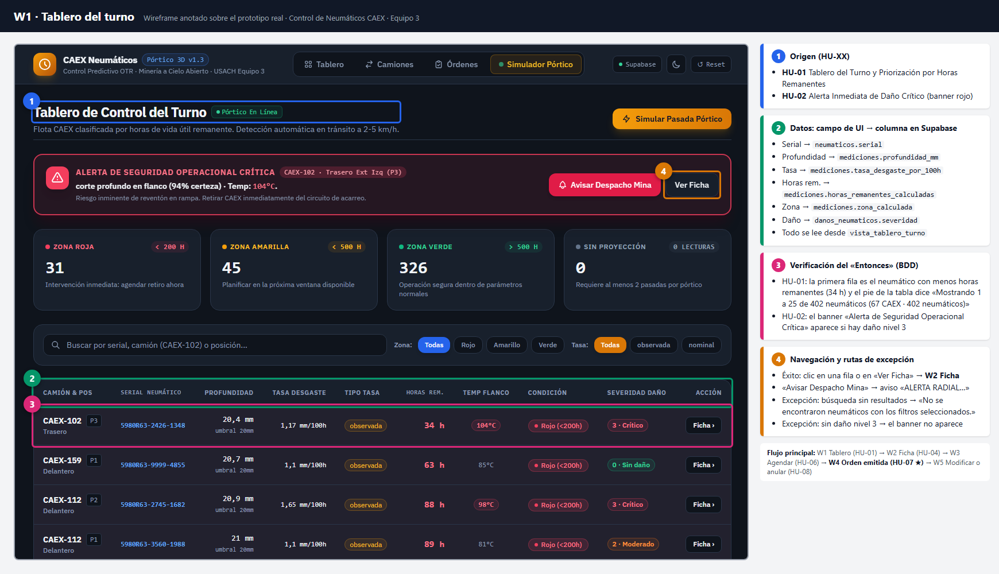
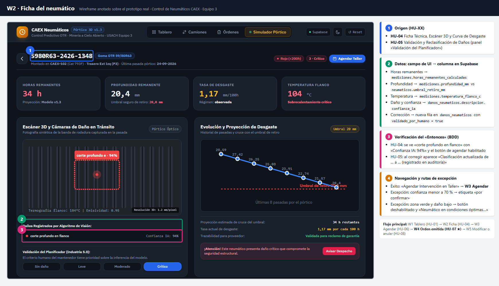
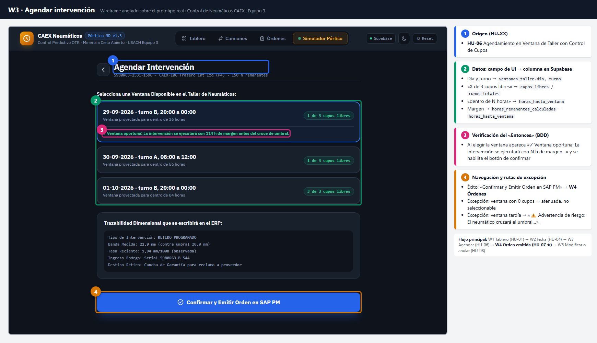
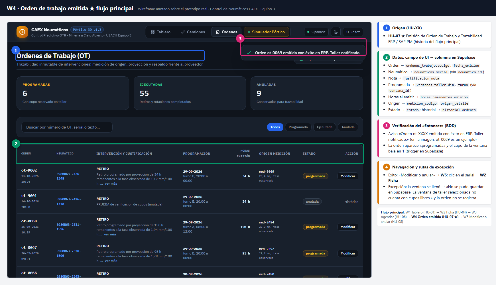
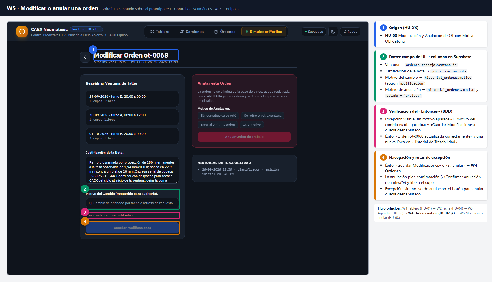

# Wireframes anotados del flujo principal

Cinco pantallas del flujo principal, capturadas del **prototipo real** ([`src/index.html`](../../src/index.html)) con datos de Supabase. Cada imagen lleva las cuatro anotaciones que pide la pauta:

| Marca | Significado |
|---|---|
| **[1] Origen** (azul) | Código `HU-XX` que justifica la pantalla (igual en Notion y en [`historias.md`](../historias.md)) |
| **[2] Datos** (verde) | Campos de la interfaz → columnas de [`datos.md`](../datos.md) y Supabase |
| **[3] Verificación** (rosado) | Elemento donde se comprueba el «Entonces» del escenario Gherkin |
| **[4] Navegación** (naranjo) | Paso a la siguiente pantalla y manejo de excepciones |

**Flujo principal:** W1 Tablero (HU-01) → W2 Ficha (HU-04) → W3 Agendar (HU-06) → **W4 Orden emitida (HU-07 ★)** → W5 Modificar o anular (HU-08)

---

## W1 · Tablero del turno (HU-01, HU-02)


- **[1]** HU-01 Tablero del Turno; HU-02 Alerta de Daño Crítico (banner rojo).
- **[2]** Serial → `neumaticos.serial` · Profundidad → `mediciones.profundidad_mm` · Tasa → `mediciones.tasa_desgaste_por_100h` · Horas rem. → `mediciones.horas_remanentes_calculadas` · Zona → `mediciones.zona_calculada` · Daño → `danos_neumaticos.severidad` (todo vía `vista_tablero_turno`).
- **[3]** La primera fila es la de menos horas remanentes (34 h). El pie dice «Mostrando 1 a 25 de 402 neumáticos».
- **[4]** Clic en una fila o en «Ver Ficha» → **W2**. Excepción: «No se encontraron neumáticos con los filtros seleccionados.»

## W2 · Ficha del neumático (HU-04, HU-05)


- **[1]** HU-04 Ficha Técnica y Curva de Desgaste; HU-05 Reclasificación (panel «Validación del Planificador»).
- **[2]** Horas, profundidad y temperatura → `mediciones`; daño y confianza → `danos_neumaticos.descripcion`, `confianza_ia`; la corrección crea una fila en `danos_neumaticos` con `validado_por_humano = true`.
- **[3]** Se ve «corte profundo en flanco» con «Confianza IA: 94%».
- **[4]** «Agendar Intervención en Taller» → **W3**. Excepción: confianza < 70 % → «por confirmar»; zona verde → botón deshabilitado.

## W3 · Agendar intervención (HU-06)


- **[1]** HU-06 Agendamiento en Ventana de Taller con Control de Cupos.
- **[2]** `ventanas_taller.dia`, `turno`, `cupos_libres` / `cupos_totales`, `horas_hasta_ventana`.
- **[3]** «✓ Ventana oportuna: La intervención se ejecutará con 114 h de margen antes del cruce de umbral.»
- **[4]** «Confirmar y Emitir Orden en SAP PM» → **W4**. Excepción: ventana sin cupos atenuada; ventana tardía → «⚠️ Advertencia de riesgo…».

## W4 · Orden de trabajo emitida (HU-07 ★ flujo principal)


- **[1]** HU-07 Emisión de Orden de Trabajo y Trazabilidad ERP / SAP PM.
- **[2]** `ordenes_trabajo.codigo`, `fecha_emision`, `justificacion_nota`, `horas_remanentes_emision`, `medicion_codigo`, `origen_detalle`, `estado`; ventana vía `ventana_id`; historial en `historial_ordenes`.
- **[3]** Aviso «Orden ot-XXXX emitida con éxito en ERP. Taller notificado.» y la orden en estado «programada». En la imagen, `ot-0069` es un ejemplo.
- **[4]** Botón «Modificar» → **W5**; clic en el serial → **W2**. Excepción: ventana llena → «No se pudo guardar en Supabase: La ventana de taller seleccionada no cuenta con cupos libres.»

## W5 · Modificar o anular una orden (HU-08)


- **[1]** HU-08 Modificación y Anulación de OT con Motivo Obligatorio.
- **[2]** Ventana → `ordenes_trabajo.ventana_id`; nota → `justificacion_nota`; motivo → `historial_ordenes.motivo`; anulación → `estado = 'anulada'`.
- **[3]** Sin motivo aparece «El motivo del cambio es obligatorio.» y «Guardar Modificaciones» queda deshabilitado.
- **[4]** «Guardar Modificaciones» o «Sí, anular» → **W4**. La anulación pide confirmación y libera el cupo.

---

## Camino alternativo: vista de camiones (HU-03)
Desde «Camiones», un clic en una posición P1 a P6 abre la misma ficha de **W2**. No se dibuja como pantalla aparte porque no forma parte del flujo principal.

## Cómo regenerar las imágenes
Con el prototipo conectado a Supabase, desde la raíz del repositorio en Git Bash:

```bash
bash scripts/wireframes/generar.sh
```

El script abre [`scripts/wireframes/anotar.html`](../../scripts/wireframes/anotar.html) en Chrome headless. Esa página carga cada pantalla del prototipo, ubica los elementos por su texto y dibuja las marcas.

Las maquetas de baja fidelidad de la Entrega 2 se conservan en [`../historico/`](../historico/).
