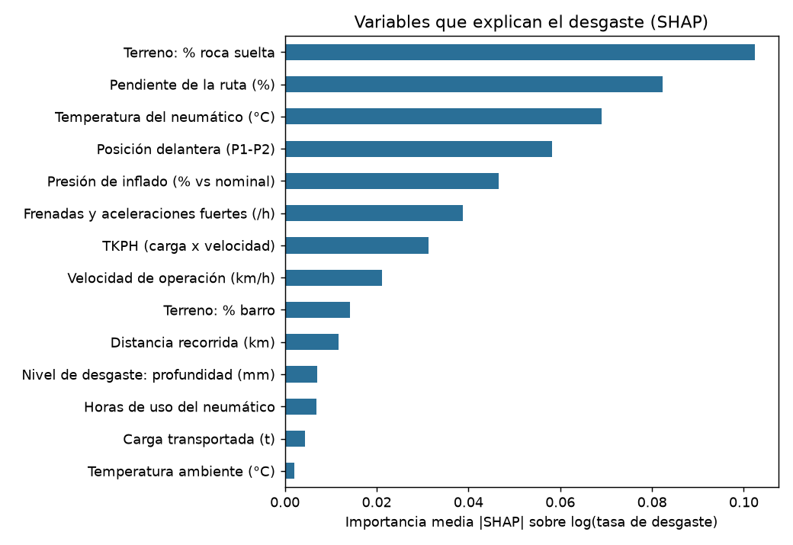
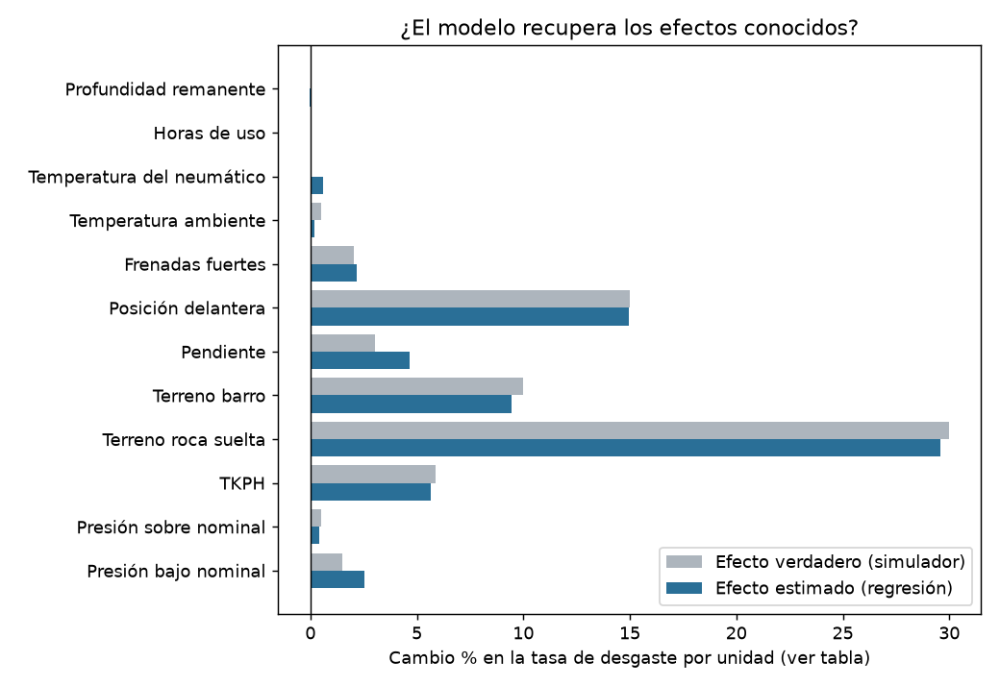
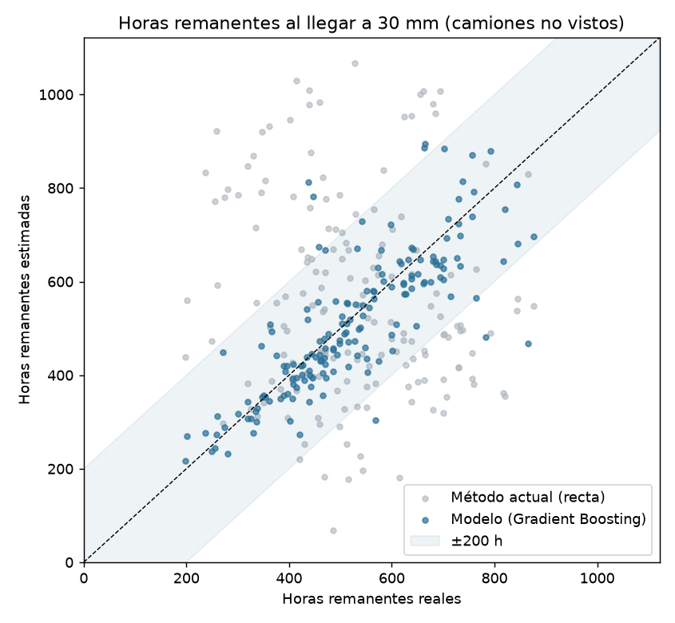

# Reporte de la PoC: modelo de desgaste y vida útil remanente

> Generado por `modelo/entrenar.py` con **datos sintéticos** (`modelo/generar_datos.py`, semilla 2026).
> Los efectos verdaderos son conocidos; el objetivo es comprobar que el método los recupera antes de usar datos reales.

**Datos:** 1,610 vidas de neumático en 67 CAEX (47% terminan por desgaste,
28% por daño y 25% siguen montadas al cierre) · 23,585 ventanas de ~200 h.
**Validación:** 14 camiones completos reservados para prueba (el modelo nunca los vio).

## 1. Variables que más explican el desgaste (SHAP)

Las cinco primeras: Terreno: % roca suelta, Pendiente de la ruta (%), Temperatura del neumático (°C), Posición delantera (P1-P2), Presión de inflado (% vs nominal).

## 2. ¿Se recuperan los efectos conocidos? (regresión multivariable)

| Variable | Unidad | Efecto verdadero | Efecto estimado |
|---|---|---|---|
| Presión bajo nominal | por 1 % | +1.5 % | +2.5 % |
| Presión sobre nominal | por 1 % | +0.5 % | +0.4 % |
| TKPH | por +10 % de TKPH | +5.9 % | +5.7 % |
| Terreno roca suelta | vs compactado | +30.0 % | +29.6 % |
| Terreno barro | vs compactado | +10.0 % | +9.4 % |
| Pendiente | por punto (bajo 6 %) | +3.0 % | +4.6 % |
| Posición delantera | vs trasera | +15.0 % | +14.9 % |
| Frenadas fuertes | por frenada/h | +2.0 % | +2.2 % |
| Temperatura ambiente | por °C | +0.5 % | +0.2 % |
| Temperatura del neumático | por °C (es consecuencia, no causa) | +0.0 % | +0.6 % |
| Horas de uso | por hora | +0.0 % | -0.0 % |
| Profundidad remanente | por mm | +0.0 % | -0.0 % |

## 3. Precisión de la tasa de desgaste (camiones no vistos)
Error absoluto medio frente a la tasa real (mm/100 h). El piso por ruido de medición del pórtico es 0.141.

| Modelo | MAE (mm/100 h) |
|---|---|
| Promedio de flota | 0.401 |
| Regresión multivariable | 0.102 |
| Gradient Boosting | 0.080 |

## 4. Horas remanentes (RUL) frente al método actual
Método actual = recta de profundidad vs horas sobre todas las mediciones del neumático (`backend/app/proyeccion.py`).
Cada celda: error medio · % de estimaciones dentro de ±200 h · % **optimistas** (predicen más de 200 h de vida extra, el error peligroso).

| Punto de evaluación | N | Método actual | Modelo |
|---|---|---|---|
| 45 mm | 167 | 363 h · 31.7 % · 37.7 % | 180 h · 62.9 % · 15.0 % |
| 30 mm | 167 | 222 h · 48.5 % · 27.5 % | 65 h · 95.2 % · 3.0 % |

## 5. Riesgo de daño prematuro (supervivencia, Cox)
Razón de riesgo (HR) por unidad. HR = 1 significa sin efecto. Índice de concordancia en camiones no vistos: **0.71**.

| Covariable | HR verdadero | HR estimado (IC 95 %) |
|---|---|---|
| frac_roca_suelta | 3.00 | 2.82 (2.09 – 3.80) |
| pendiente_rel | 1.08 | 1.09 (1.02 – 1.15) |
| sobrecarga_pct | 1.05 | 1.05 (1.02 – 1.09) |
| frac_temp_sobre_95 | 2.00 | 2.68 (1.68 – 4.27) |
| presion_baja_pct | 1.00 | 0.99 (0.96 – 1.03) |
| frenadas_por_h | 1.00 | 1.09 (1.04 – 1.14) |
