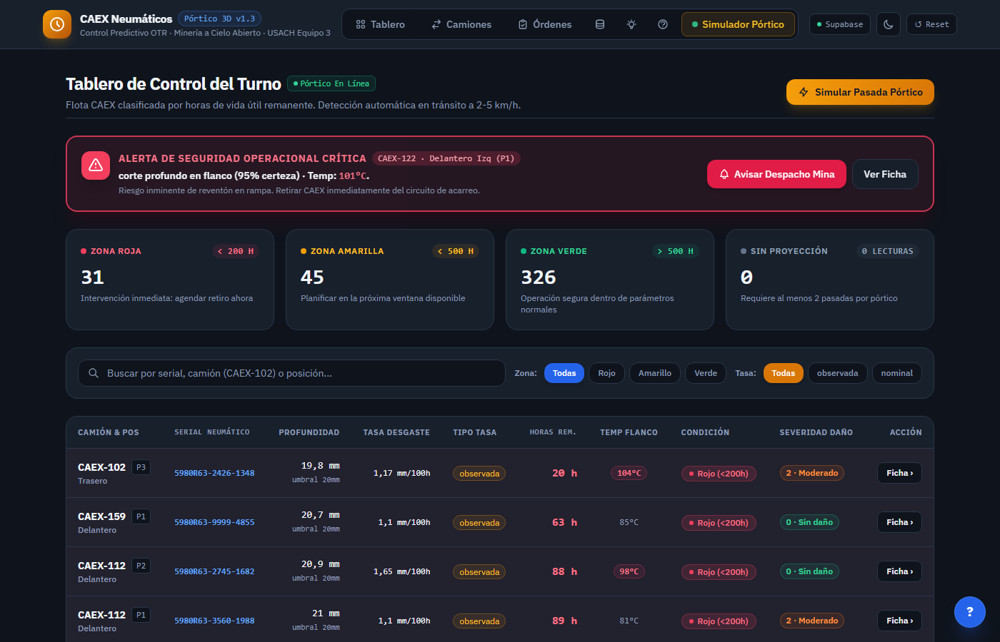
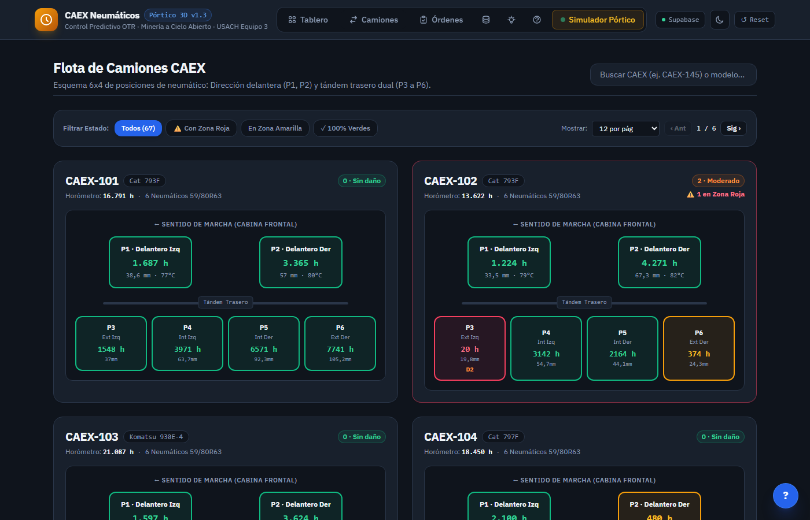
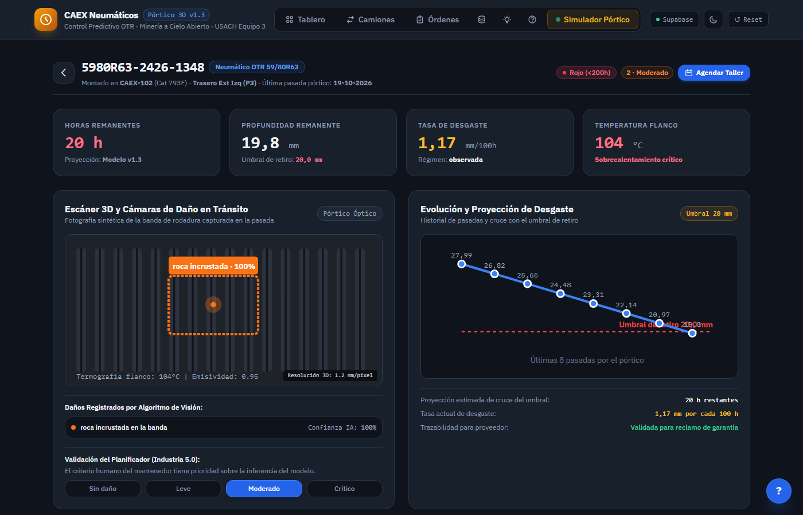
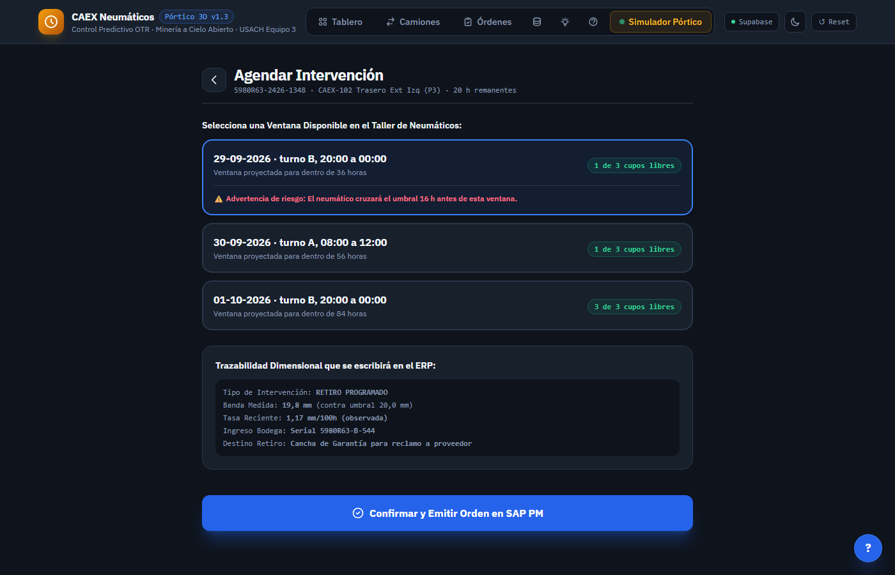
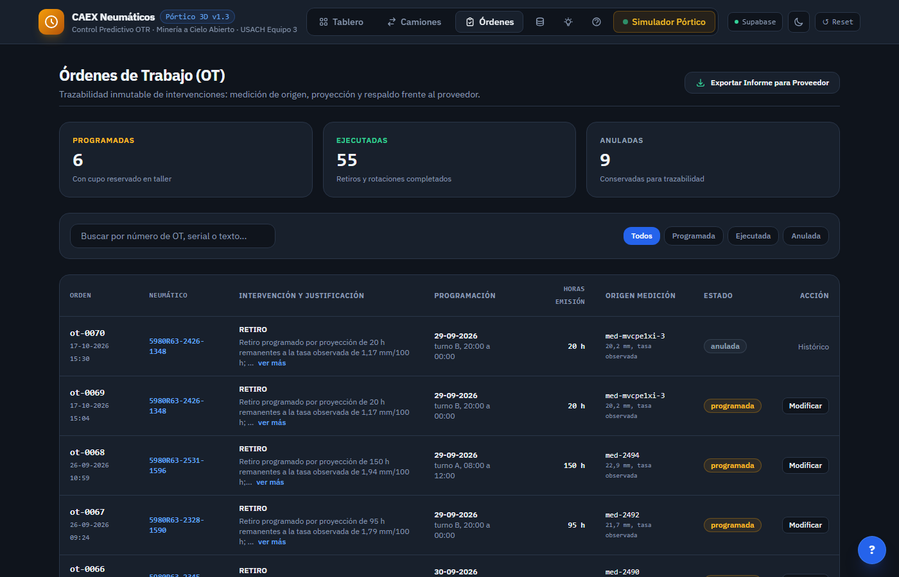
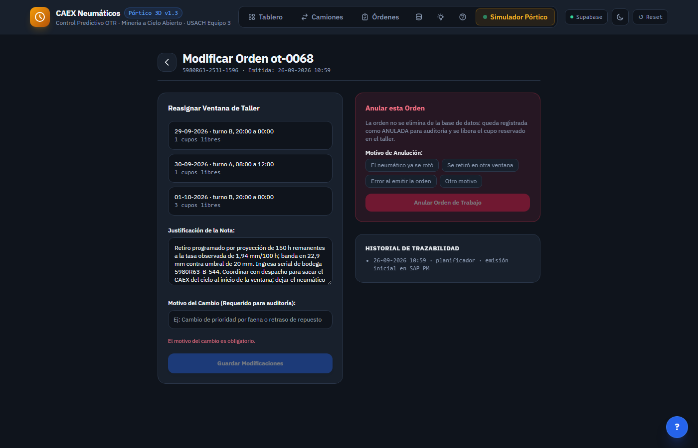
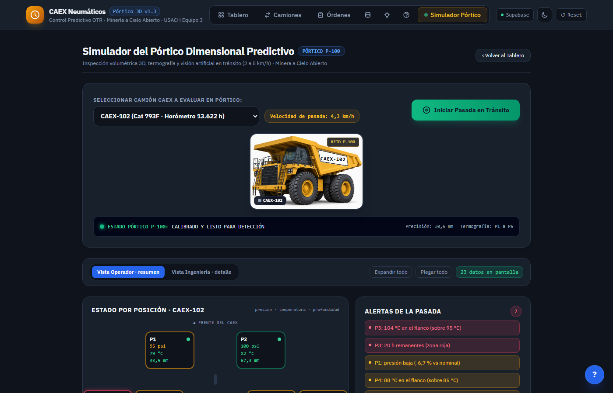
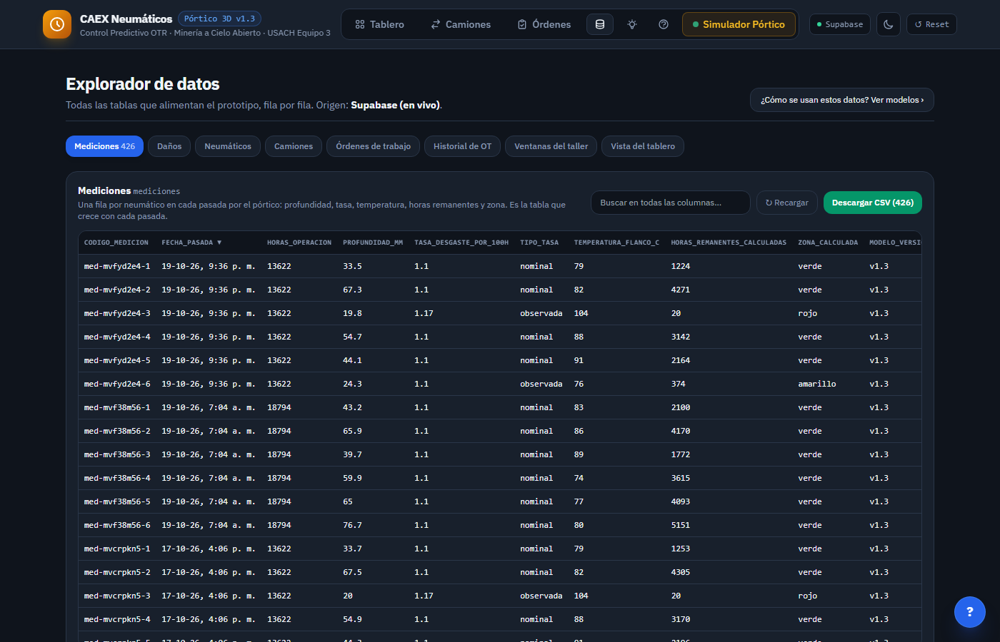
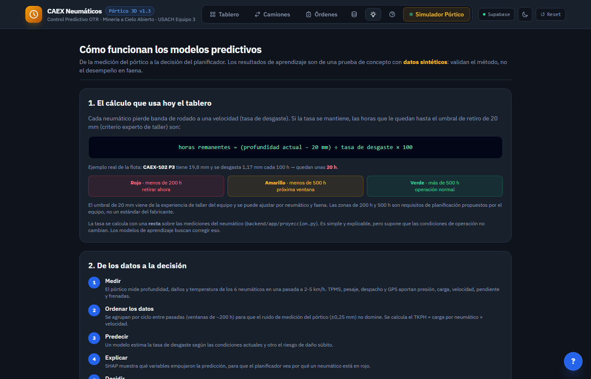

# Manual de uso · Control Predictivo de Neumáticos CAEX

**Versión 1.0 · 24-10-2026 · Equipo 3, Ingeniería Digital USACH**
Aplicación: https://control-neumaticos-caex-frontend.vercel.app

Este manual está escrito para cuatro lectores:

| Lector | Lea primero |
|---|---|
| **Planificador de mantención de neumáticos** | [Primeros pasos](#primeros-pasos), [Tablero](#tablero), [Ficha](#ficha), [Agendar](#agendar), [Órdenes](#ordenes) |
| **Operador del pórtico** | [Primeros pasos](#primeros-pasos), [Simulador del pórtico](#simulador) |
| **Profesor y evaluadores** | [Para qué sirve](#para-que-sirve), [Para profesores y evaluadores](#evaluadores) |
| **Cualquier usuario con dudas** | [Indicadores](#indicadores), [Preguntas frecuentes](#preguntas-frecuentes), [Glosario](#glosario) |

En cada pantalla de la aplicación, el botón **?** (abajo a la derecha) abre la sección de este manual que corresponde a esa pantalla.

> **Importante:** es un prototipo académico. Las mediciones, órdenes y daños se guardan en una base de datos real (Supabase), pero los datos de la flota son de **demostración**, y la telemetría de presión (TPMS), carga y TKPH del simulador es **simulada**.

---

## 1. Para qué sirve

La herramienta ayuda a **retirar cada neumático antes de que falle en operación**. Para eso:

1. Un **pórtico** mide los 6 neumáticos de cada CAEX cuando pasa a 2-5 km/h: profundidad de la banda, daños y temperatura.
2. El sistema calcula las **horas remanentes**: cuántas horas de operación le quedan a cada neumático hasta llegar al **umbral de retiro de 20 mm** (criterio experto de taller; se puede ajustar según el neumático y la faena).
3. Cada neumático queda en una **zona de riesgo**:

| Zona | Horas remanentes | Qué hacer |
|---|---|---|
| 🔴 **Roja** | Menos de 200 h | Programar el retiro **ahora** |
| 🟡 **Amarilla** | Entre 200 y 500 h | Programar en la próxima ventana del taller |
| 🟢 **Verde** | 500 h o más | Operación normal |

Las zonas de 200 h y 500 h son **requisitos de planificación propuestos por el equipo**, no un estándar del fabricante.

4. El planificador agenda la intervención en una **ventana del taller con cupo** y emite la **orden de trabajo (OT)**, que queda ligada a la medición que la originó.

**Fórmula:** horas remanentes = (profundidad actual − 20 mm) ÷ tasa de desgaste (mm por cada 100 h) × 100.

---

## 2. Primeros pasos

1. Abra la aplicación en el navegador (Chrome, Edge o Firefox actualizados).
2. Revise el **indicador de origen de datos**, arriba a la derecha:
   - **● Supabase** (verde): los datos vienen de la base y sus cambios se guardan.
   - **● modo local** (gris): no hay conexión. La aplicación funciona con datos guardados en su navegador; los cambios no los verán otras personas.
3. Use la **barra de navegación** superior:

| Botón | Pantalla | Para qué |
|---|---|---|
| Tablero | `#/` | Flota completa ordenada por riesgo |
| Camiones | `#/c` | Cada CAEX con sus 6 posiciones |
| Órdenes | `#/o` | Órdenes de trabajo emitidas |
| Datos (ícono de cilindro) | `#/datos` | Tablas completas de la base y descarga CSV |
| Modelos (ícono de ampolleta) | `#/modelos` | Cómo se calcula el riesgo |
| Ayuda (ícono de signo de interrogación) | `#/ayuda` | Este manual |
| Simulador Pórtico | `#/sim` | Simular la pasada de un CAEX |

4. Otros controles: el ícono de luna cambia entre tema oscuro y claro; **↺ Reset** vuelve a leer los datos desde Supabase (en modo local restaura los datos de demostración).

---

## 3. Revisar el turno en el Tablero

**Cuándo:** al inicio de cada turno.

1. Lea las **cuatro tarjetas** de arriba: cuántos neumáticos hay en zona roja, amarilla, verde y sin proyección. Un clic en una tarjeta filtra la tabla por esa zona.
2. La **tabla** muestra los neumáticos ordenados de **menor a mayor horas remanentes**: los primeros son los más urgentes.
3. Para acotar la lista:
   - **Buscar:** escriba un serial, un camión (ej. `CAEX-102`) o una posición.
   - **Zona:** Todas, Rojo, Amarillo o Verde.
   - **Tasa:** observada (medida en el neumático) o nominal (valor de referencia).
4. Abajo puede cambiar cuántas filas ver (25, 50, 100 o todas) y avanzar de página.
5. Un clic en **Ficha ›** abre el detalle de ese neumático.

Si la búsqueda no encuentra nada, aparece *«No se encontraron neumáticos con los filtros seleccionados»*: limpie el buscador o elija la zona **Todas**.

---

## 4. Responder a una alerta de daño crítico

Cuando un neumático tiene **daño nivel 3** (corte profundo, sobrecalentamiento o delaminación), aparece arriba del Tablero un **banner rojo** «Alerta de Seguridad Operacional Crítica», con el camión, la posición, el daño, su certeza y la temperatura.

1. Presione **Avisar Despacho Mina** para registrar el aviso al despachador y sacar el CAEX del ciclo.
2. Presione **Ver Ficha** para revisar el neumático y agendar su retiro.

> En el prototipo, el aviso a despacho se muestra en pantalla pero todavía no se envía ni se guarda en la base.

---

## 5. Revisar un camión completo

1. Abra **Camiones**. Cada tarjeta es un CAEX con su modelo, horómetro y las 6 posiciones dibujadas como en el chasis: **P1-P2** adelante, **P3-P4** atrás a la izquierda y **P5-P6** atrás a la derecha.
2. Cada posición muestra sus horas remanentes con el color de su zona. Sirve para detectar **desgaste desigual entre ejes** y decidir rotaciones.
3. Filtre por estado (**Con Zona Roja**, **En Zona Amarilla**, **100 % Verdes**) o busque un camión.
4. Un clic en una posición abre la ficha de ese neumático.

---

## 6. Revisar un neumático en su ficha

La ficha reúne la evidencia para decidir el retiro:

| Elemento | Qué muestra |
|---|---|
| Tarjetas superiores | Horas remanentes, profundidad contra el umbral de 20 mm, tasa de desgaste y temperatura del flanco |
| Escáner 3D y cámaras | Imagen de la banda con el daño marcado y su **confianza** (%) |
| Evolución y proyección | Profundidad en las últimas pasadas y la línea punteada del umbral de retiro |
| Acción recomendada | Si conviene intervenir o seguir operando |

**Si la confianza de un daño es menor a 70 %**, aparece la etiqueta **«por confirmar»**: revíselo antes de decidir.

### Corregir la clasificación de daño
Si el modelo de visión se equivocó, en **Validación del Planificador (Industria 5.0)** elija el nivel correcto (**Sin daño**, **Leve**, **Moderado** o **Crítico**). La corrección queda registrada con su fecha y como **validada por una persona**; el juicio del planificador prevalece sobre la inteligencia artificial.

### Cuándo no se puede agendar
Si el neumático está en **zona verde** y su daño es bajo, el botón **Agendar Intervención en Taller** aparece deshabilitado y la acción recomendada dice *«Neumático en condiciones óptimas para continuar operación»*.

---

## 7. Agendar una intervención y emitir la orden

1. Desde la ficha, presione **Agendar Intervención en Taller**.
2. Elija una **ventana del taller** (día y turno). Cada una muestra sus cupos libres (máximo 3).
   - Una ventana **sin cupos** aparece atenuada y no se puede elegir.
   - Si la ventana llega **antes** del cruce del umbral: *«✓ Ventana oportuna…»*, con las horas de margen.
   - Si llega **después**: *«⚠️ Advertencia de riesgo: el neumático cruzará el umbral…»*. Elija una ventana más próxima.
3. Revise la **trazabilidad** que se escribirá en la orden: profundidad, tasa, serial de reemplazo y destino del neumático retirado.
4. Presione **Confirmar y Emitir Orden en SAP PM**.

La orden queda **programada**, el cupo de la ventana baja en 1 y aparece el aviso *«Orden ot-XXXX emitida con éxito»*. Si otra persona ocupó el último cupo justo antes, la base rechaza la orden y verá *«No se pudo guardar en Supabase…»*.

---

## 8. Consultar las órdenes de trabajo

1. Abra **Órdenes**. Arriba ve cuántas están **programadas**, **ejecutadas** y **anuladas**.
2. Busque por número de OT, serial o texto de la nota, y filtre por estado.
3. Cada orden muestra el neumático, la nota, la ventana, las horas remanentes al emitirla y la **medición de origen**: esa es la trazabilidad que respalda el retiro frente al taller y al proveedor.
4. **Exportar Informe para Proveedor** descarga un CSV con las órdenes para reclamos de garantía.

---

## 9. Modificar o anular una orden

Solo las órdenes **programadas** se pueden cambiar. Presione **Modificar** en la orden.

**Para modificarla:**
1. En **Reasignar Ventana de Taller**, elija otra ventana con cupo (opcional).
2. Edite la **Justificación de la Nota** si corresponde.
3. Escriba el **Motivo del Cambio**. Es **obligatorio**: sin motivo, el botón **Guardar Modificaciones** queda deshabilitado.
4. Guarde. El cupo de la ventana anterior se libera y el de la nueva se descuenta.

**Para anularla:**
1. En **Anular esta Orden**, elija un motivo.
2. Presione **Anular Orden de Trabajo** y confirme con **Sí, anular**.

Las órdenes **nunca se borran**: quedan como *anuladas*, con su motivo en el **Historial de Trazabilidad**.

---

## 10. Usar el simulador del pórtico

El simulador reproduce lo que verá el **operador del pórtico** cuando un CAEX cruza el punto de control.

1. Elija el camión en **Seleccionar Camión CAEX**.
2. Presione **Iniciar Pasada en Tránsito**. La pasada **registra 6 mediciones nuevas en la base**: úsela solo cuando quiera generar datos.
3. Lea el **Estado por posición**: cada neumático muestra presión, temperatura y profundidad, y su **borde** indica el peor estado (verde, ámbar, rojo o gris).
4. Revise las **Alertas de la pasada**, ordenadas de la más grave a la menos grave.

### Vista Operador y Vista Ingeniería
- **Vista Operador** (predeterminada): resumen para una pasada de pocos segundos, con unos 23 datos en pantalla. El simulador siempre parte en esta vista.
- **Vista Ingeniería**: abre todas las secciones (unos 125 datos), para análisis.
- **Expandir todo / Plegar todo** abre o cierra las secciones. El contador **«N datos en pantalla»** se pone ámbar sobre 60 y rojo sobre 120.

### Secciones
| Sección | Contenido |
|---|---|
| Telemetría de presión (TPMS) | Presión en psi y bar, desviación respecto de la nominal y estado del sensor: **Operativo**, **Sin señal** o **Falla / calibración** (un clic en el estado lo cambia, para practicar) |
| Medición de temperatura | Temperatura del flanco (pórtico) e interna (TPMS) y su diferencia |
| Carga, velocidad y TKPH | Carga del ciclo, velocidad de pasada y media, y TKPH por posición |
| Inspección fotográfica y dimensional | Imagen y medidas de cada neumático |
| Arreglo de cámaras del pórtico | Estado de las 8 cámaras (un clic simula una falla) |
| Registro de la pasada | Eventos de la última pasada |

---

## 11. Consultar y descargar los datos

1. Abra **Datos** (ícono de base de datos).
2. Elija una tabla en las pestañas. La más importante es **Mediciones**: una fila por neumático en cada pasada.
3. **Buscar** filtra en todas las columnas; un clic en un **encabezado** ordena por esa columna (otro clic invierte el orden).
4. **Descargar CSV** baja la tabla filtrada; se abre en Excel.
5. **↻ Recargar** vuelve a leer la tabla desde la base.

Los identificadores técnicos (`id`, `…_id`) aparecen al final y abreviados; pase el mouse sobre ellos para ver el valor completo.

---

## 12. Entender los modelos

La página **Modelos** explica, sin necesidad de conocimientos técnicos:
1. El cálculo que usa hoy el Tablero (una recta sobre las mediciones del neumático).
2. El camino de los datos a la decisión: medir, ordenar, predecir, explicar y decidir.
3. Cada modelo, marcado como **en uso**, **prueba de concepto** o **futuro**.
4. Los resultados de la prueba de concepto con datos sintéticos.

> Los modelos de aprendizaje (Gradient Boosting, supervivencia) todavía **no** reemplazan el cálculo del Tablero: están validados solo con datos sintéticos.
>
> En los resultados, «dentro de ±200 h» mide el **error de la estimación**; no demuestra que el modelo anticipe una falla con 200 h de antelación.

La página también enlaza el **respaldo bibliográfico** de cada método y parámetro, preparado por Nicolás Echeverría.

---

## 13. Qué significa cada indicador

| Indicador | Valores |
|---|---|
| Zona | 🔴 < 200 h · 🟡 200-500 h · 🟢 ≥ 500 h · ⚪ sin proyección |
| Nivel de daño | 0 Sin daño · 1 Leve · 2 Moderado · 3 Crítico (genera alerta) |
| Confianza del daño | Bajo 70 %: «por confirmar» |
| Temperatura del flanco | Normal < 85 °C · Advertencia 85-95 °C · Crítico > 95 °C |
| Presión (TPMS) | Nominal 102 psi · Advertencia sobre ±5 % · Crítico sobre ±10 % |
| Sensor TPMS | Operativo · Sin señal · Falla / calibración |
| Estado de la OT | Programada · Ejecutada · Anulada |
| Velocidad de captura | 2 a 5 km/h |

Los umbrales de temperatura (85 °C y 95 °C), de presión y las zonas de 200/500 h son **valores del prototipo** que deben confirmarse con el fabricante y la faena. El nivel de respaldo de cada uno está en `docs/respaldo-bibliografico.md`.

---

## 14. Preguntas frecuentes y problemas comunes

**No veo mis cambios.** Recargue la página con **Ctrl + F5**. Si el indicador dice *modo local*, sus cambios quedaron solo en su navegador.

**El indicador dice «modo local».** No hay conexión con la base. Revise su conexión a internet y recargue. Puede seguir usando la aplicación, pero otras personas no verán sus cambios.

**No puedo presionar «Agendar Intervención en Taller».** El neumático está en zona verde y sin daño relevante: no requiere intervención.

**No puedo elegir una ventana.** No tiene cupos libres. Elija otra o anule una orden que ya no corresponda.

**«Guardar Modificaciones» está deshabilitado.** Falta el **Motivo del Cambio**, que es obligatorio.

**No puedo borrar una orden.** Es intencional: las órdenes se anulan, no se borran, para conservar la trazabilidad.

**Al buscar no aparece nada.** Revise que la zona esté en **Todas** y que el texto no tenga errores (por ejemplo, `CAEX-102`, con guion).

---

## 15. Glosario

| Término | Significado |
|---|---|
| **CAEX** | Camión de extracción minera (Cat 793F, Cat 797F, Komatsu 930E-4) |
| **Neumático OTR** | Neumático fuera de carretera (*off-the-road*), en este caso 59/80R63 |
| **Pórtico** | Estructura con escáner 3D, cámaras, termografía y RFID que mide los neumáticos en tránsito |
| **Pasada** | Cruce de un CAEX por el pórtico; genera una medición por neumático |
| **Profundidad de banda** | Altura remanente del dibujo del neumático, en mm |
| **Tasa de desgaste** | Milímetros que pierde la banda cada 100 horas de operación |
| **Horas remanentes** | Horas de operación que quedan hasta el umbral de 20 mm |
| **Umbral de retiro** | 20 mm: bajo esa profundidad el neumático debe retirarse. Criterio experto de taller, ajustable según el neumático y la faena |
| **Ventana del taller** | Turno del taller con cupos para intervenir neumáticos |
| **OT** | Orden de trabajo enviada al taller (y al ERP SAP PM) |
| **TPMS** | Sistema de monitoreo de presión de neumáticos (sensor en la válvula) |
| **TKPH** | Toneladas-kilómetro por hora: carga por neumático × velocidad media; indica el esfuerzo térmico del neumático |
| **Termografía** | Medición de temperatura por cámara infrarroja |
| **SHAP** | Método que muestra cuánto aporta cada variable a una predicción |
| **Datos censurados** | Neumáticos retirados antes de fallar: no se sabe cuánto más habrían durado |

---

## 16. Para profesores y evaluadores

### Arquitectura
| Capa | Tecnología | Dónde verla |
|---|---|---|
| Interfaz | HTML, JavaScript y Tailwind, sin compilación | `src/index.html` |
| Datos | Supabase (PostgreSQL) con triggers de cupos y políticas RLS | `docs/schema.sql`, `docs/datos.md` |
| Despliegue | Vercel, publicación automática desde la rama `main` | https://control-neumaticos-caex-frontend.vercel.app |
| Código y revisión | GitHub, ramas `dev` → `main` por Pull Request aprobado | https://github.com/mavalosc/control-neumaticos-caex |
| Gestión | Notion: Roadmap con HU-01 a HU-08 y Kanban | Página Grupo 3 del curso |

### Dónde está cada entregable
| Entregable | Archivo |
|---|---|
| Historias de usuario y criterios Gherkin | `docs/historias.md` |
| Wireframes anotados W1 a W5 | `docs/wireframes/` |
| Diccionario de datos y Tidy Data | `docs/datos.md` |
| Bitácora de uso de IA | `docs/bitacora-ia.md` |
| Modelo predictivo (prueba de concepto) | `docs/modelo.md`, `modelo/` |
| Respaldo bibliográfico de métodos y parámetros | `docs/respaldo-bibliografico.md` |
| Experiencia de usuario y especificaciones | `docs/experiencia-usuario.md` |
| Registro de propuestas de cambio | `docs/propuestas.md` |

### Flujo principal para evaluar en 5 minutos
1. **Tablero** → anote el neumático de la primera fila (el de menos horas remanentes).
2. **Ficha** de ese neumático → revise la curva y el daño.
3. **Agendar** → elija una ventana con cupo y emita la orden (HU-07, flujo principal).
4. **Datos** → pestaña *Órdenes de trabajo*: la orden nueva aparece con su medición de origen; pestaña *Ventanas del taller*: el cupo bajó en 1.
5. **Modificar** la orden sin motivo → el botón queda deshabilitado (excepción de HU-08).

### Qué es real y qué es simulado
| Componente | Estado |
|---|---|
| Mediciones, daños, órdenes, ventanas e historial | Guardados en Supabase |
| Flota (67 CAEX, 405 neumáticos) | Datos de demostración |
| Captura física del pórtico | Simulada (botón «Iniciar Pasada en Tránsito») |
| TPMS, carga, velocidad del ciclo y TKPH | Simulados en el navegador, no se guardan |
| Modelos de aprendizaje | Prueba de concepto con datos sintéticos |
